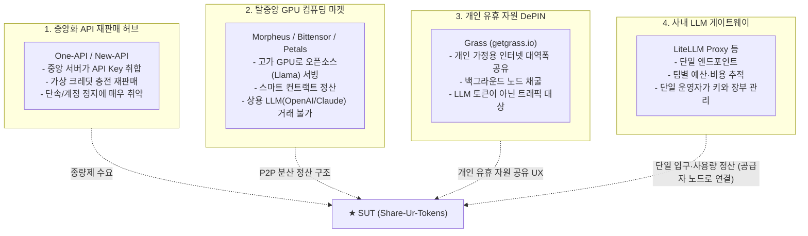

# SUT 시장 유사 서비스 분석 및 경쟁력 비교 (Market Analysis)

> **기존 LLM 중계 및 탈중앙 AI 프로젝트 분석과 SUT(Share-Ur-Tokens)의 독창적 시장 기회(Niche)**

---

## 1. 기존 시장의 4대 유사 진영 분석

시장에는 SUT의 구성 요소를 부분적으로 가진 4가지 진영이 있습니다. 이 중 SUT의 핵심 사용자(AI 자원을 함께 쓰는 여러 주체)와 가장 직접 겹치는 것은 **진영 D(사내 LLM 게이트웨이)**입니다.

---

### 진영 A. 중앙화 API 재판매/공유 허브 (One-API, New-API 계열)
- **대표 프로젝트**: [`songquanpeng/one-api`](https://github.com/songquanpeng/one-api) (GitHub 스타 2만+), [`QuantumNous/new-api`](https://github.com/QuantumNous/new-api)
- **동작 방식**: 중앙 운영자가 단일 웹 서버를 띄우고, 관리자가 여러 개의 OpenAI/Claude API Key를 데이터베이스에 등록한 뒤 사용자들에게 종량제 서브키를 충전 판매.
- **치명적 한계**:
  - **100% 중앙화 서버**: 중앙 관리자가 API Key를 쥐고 있어 먹튀/키 탈취 위험.
  - **단속에 취약**: 고정된 클라우드 IP(AWS 등)를 사용하므로 OpenAI에 의해 쉽게 탐지 및 일괄 차단(Mass Ban).
  - **P2P 직거래 불가**: 개인이 남는 토큰을 시장에 내놓고 팔 수 있는 구조가 아님.

---

### 진영 B. 탈중앙 오픈소스 GPU 컴퓨팅 마켓 (Morpheus, Bittensor, Petals)
- **대표 프로젝트**:
  - **Morpheus (MOR)**: Arbitrum/Base 기반 스마트 컨트랙트로 독립 GPU 노드와 사용자를 연결해 오픈소스 LLM(Llama 등) 추론을 중계하고 토큰으로 정산하는 P2P 네트워크.
  - **Bittensor (TAO)**: 시총 수조 원 규모의 탈중앙 AI 추론/학습 서브넷 네트워크.
  - **Petals**: 분산 PC 여러 대가 토렌트처럼 오픈소스 LLM 가중치를 나눠 들고 협력 추론.
- **치명적 한계**:
  - **오픈소스 로컬 모델에만 국한**: 고가의 엔비디아 고성능 GPU를 가진 전문 채굴자만 공급자로 참여 가능.
  - **상용 LLM 거래 부재**: 일반 대중이 가장 많이 소비하는 상용 모델(OpenAI, Anthropic 등의 API 모델)은 다루지 않음.

---

### 진영 C. 개인 유휴 자원 공유 DePIN (Grass, Wynd Network)
- **대표 프로젝트**: **Grass (getgrass.io)** (솔라나 기반, 실사용자 200만 명 돌파)
- **동작 방식**: 사용자가 PC에 경량 노드를 켜두면, 쓰지 않는 유휴 인터넷 대역폭을 AI 데이터 크롤링 기업에 빌려주고 토큰을 보상받음.
- **시사점**: "개인의 남는 유휴 자원을 백그라운드 P2P로 내놓는다"는 **UX는 SUT와 유사**하지만, 대상이 대역폭이고 금전 보상 구조라는 점에서 SUT의 포인트 순환 구조와 다름.

---

### 진영 D. 사내 LLM 게이트웨이 (LiteLLM Proxy 등)
- **동작 방식**: 조직이 게이트웨이 서버 하나를 운영하고, 여러 LLM 공급원의 키를 중앙에 등록합니다. 구성원은 단일 엔드포인트로 여러 모델을 쓰고, 팀별 예산과 사용량이 집계됩니다.
- **SUT보다 나은 점**: 키가 중앙에만 있어 관리가 안전하고, 민감 데이터가 회사 인프라만 거치며, 운영이 단순합니다. **조직 하나가 중앙에서 계약을 관리하는 상황이라면 게이트웨이가 더 적합합니다.**
- **한계**:
  - **단일 운영자 전제**: 게이트웨이와 장부를 한 주체가 쥡니다. 소유자가 다른 여러 주체가 함께 쓰려면 누가 운영하고 장부를 관리할지부터 합의해야 합니다.
  - **중앙 등록 전제**: 흩어진 GPU(데스크톱, 부서 서버)를 쓰려면 하나씩 등록하고 접근 가능하게 열어야 합니다.
  - **위에서 배분하는 예산**: 기여한 만큼 쓰는 아래에서 위로의 순환 구조가 아닙니다.
- **SUT와의 관계**: 경쟁 상대이면서 구성 요소입니다. 게이트웨이를 SUT의 공급자 노드 하나로 연결할 수 있고, SUT Agent의 로컬 게이트웨이도 같은 도구로 구현할 수 있습니다. (상세: [시스템 개요 1.4절](system-overview.md))

---

## 2. 기존 서비스 vs SUT 종합 비교

| 비교 항목 | One-API / New-API | Morpheus / Bittensor | 사내 LLM 게이트웨이 | **SUT (Share-Ur-Tokens)** |
| :--- | :---: | :---: | :---: | :---: |
| **네트워크 구조** | 중앙화 웹 서버 (SPOF) | 탈중앙 P2P | 조직 내 중앙 서버 | **P2P + 분산 Broker (공개형 / 폐쇄형 배포)** |
| **공유 대상** | 중앙 업자의 API Key | 고비용 오픈소스 GPU 컴퓨팅 | 조직이 중앙 등록한 공급원 | **여러 주체가 각자 운영하는 노드의 상용 LLM과 GPU 모델(폐쇄형 연합) + 참여자의 GPU 오픈 모델(공개 네트워크)** |
| **공급자 진입 장벽** | 일반 개인 참여 불가 | 고가 GPU 서버 필수 (수백만 원) | 운영자가 중앙 등록 | **API Key 또는 로컬 GPU 보유자 참여 가능 (소비자용 구독은 제외)** |
| **소비자 연동** | Web UI / 중앙 엔드포인트 | 전용 지갑 / 전용 SDK | OpenAI 호환 단일 엔드포인트 | **Cursor, Continue 등 오픈 에이전트 직결** |
| **공급원 이용 조건** | 중앙 업자가 API를 재판매 (약관 위반 소지) | 자체 오픈 모델 (라이선스 준수) | 조직 계약 범위 안 | **공급원별 이용 조건 준수 (허용하는 네트워크에만 공급)** |
| **정산 방식** | 무통장/PG 충전 (중앙 DB) | 블록체인 스마트 컨트랙트 | 운영자의 중앙 DB (팀별 예산) | **실시간 가치평가 포인트 + Broker 합의형 블록체인 원장 (상호신용, 합계 0)** |

---

## 3. SUT의 시장 기회와 포지셔닝

1. **겨냥하는 빈자리**:
   - 조직 하나 안에서는 사내 게이트웨이가 이미 단일 입구와 사용량 정산을 제공합니다. SUT가 노리는 곳은 그 바깥, **소유자가 서로 다른 여러 주체가 단일 운영자 없이 AI 자원을 함께 쓰는 영역**입니다. 예를 들어 부서 간, 계열사 간, 협력사 간, 연구 컨소시엄, 공개 커뮤니티입니다.
2. **기술적 차별화**:
   - **공동 장부**: Broker 합의형 원장으로 어느 한 주체도 기록을 고칠 수 없는 공동 정산을 제공합니다.
   - **흩어진 공급의 자동 합류**: 소유자가 다른 GPU가 Agent만 켜면 참여합니다.
   - **기여 기반 순환**: 모델·시간대별 실시간 가치평가 포인트로, 공급한 만큼 씁니다.
   - **게이트웨이와의 결합**: 사내 게이트웨이를 공급자 노드로 연결해, 조직 내부는 게이트웨이로, 조직 사이는 SUT로 이어 씁니다.
3. **포지셔닝**:
   - **"소유자가 다른 AI 자원을 단일 운영자 없이 함께 쓰는 연합(federation) 네트워크"**로 정의합니다. 사내 게이트웨이를 대체하지 않고, 게이트웨이가 닿지 않는 조직 사이의 공유를 맡습니다.
