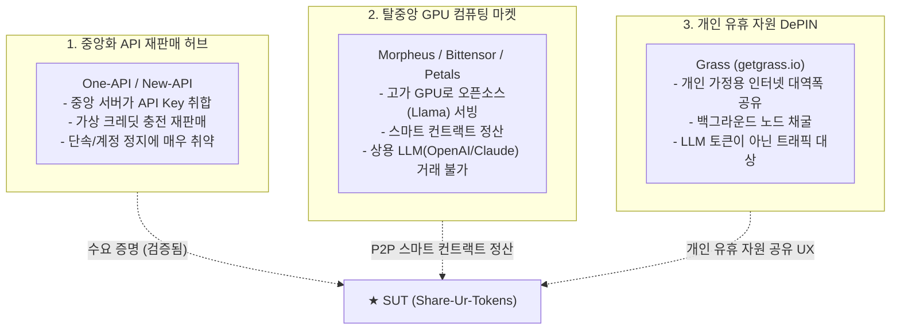

# SUT 시장 유사 서비스 분석 및 경쟁력 비교 (Market Analysis)

> **기존 LLM 중계 및 탈중앙 AI 프로젝트 분석과 SUT(Share-Ur-Tokens)의 독창적 시장 기회(Niche)**

---

## 1. 기존 시장의 3대 유사 진영 분석

현재 시장에는 SUT의 구성 요소를 부분적으로 가진 3가지 진영이 존재하지만, **"개인의 상용 LLM 토큰을 P2P 블록체인으로 거래하는 서비스"**는 아직 존재하지 않습니다.

---

### 진영 A. 중앙화 API 재판매/공유 허브 (One-API, New-API 계열)
- **대표 프로젝트**: [`songquanpeng/one-api`](https://github.com/songquanpeng/one-api) (GitHub 스타 2만+), [`QuantumNous/new-api`](https://github.com/QuantumNous/new-api)
- **동작 방식**: 중앙 운영자가 단일 웹 서버를 띄우고, 관리자가 여러 개의 OpenAI/Claude API Key를 데이터베이스에 등록한 뒤 사용자들에게 종량제 서브키를 충전 판매.
- **치명적 한계**:
  - **100% 중앙화 서버**: 중앙 관리자가 API Key를 쥐고 있어 먹튀/키 탈취 위험.
  - **단속에 취약**: 고정된 클라우드 IP(AWS 등)를 사용하므로 OpenAI에 의해 쉽게 탐지 및 일괄 차단(Mass Ban).
  - **P2P 직거래 불가**: 개인이 남는 토큰을 시장에 내놓고 팔 수 있는 구조가 아님.

---

### 진영 B. 탈중앙 오픈소스 GPU 컴퓨팅 마켓 (Morpheus, Bittensor, Petals)
- **대표 프로젝트**:
  - **Morpheus (MOR)**: Arbitrum/Base 기반 스마트 컨트랙트로 독립 GPU 노드와 사용자를 연결해 오픈소스 LLM(Llama 등) 추론을 중계하고 토큰으로 정산하는 P2P 네트워크.
  - **Bittensor (TAO)**: 시총 수조 원 규모의 탈중앙 AI 추론/학습 서브넷 네트워크.
  - **Petals**: 분산 PC 여러 대가 토렌트처럼 오픈소스 LLM 가중치를 나눠 들고 협력 추론.
- **치명적 한계**:
  - **오픈소스 로컬 모델에만 국한**: 고가의 엔비디아 고성능 GPU를 가진 전문 채굴자만 공급자로 참여 가능.
  - **상용 LLM 거래 부재**: 일반 대중이 가장 많이 소비하는 상용 모델(OpenAI GPT-4o, Claude 3.5 Sonnet 등)의 구독 잔여 토큰은 다루지 않음.

---

### 진영 C. 개인 유휴 자원 공유 DePIN (Grass, Wynd Network)
- **대표 프로젝트**: **Grass (getgrass.io)** (솔라나 기반, 실사용자 200만 명 돌파)
- **동작 방식**: 사용자가 PC에 경량 노드를 켜두면, 쓰지 않는 유휴 인터넷 대역폭을 AI 데이터 크롤링 기업에 빌려주고 토큰을 보상받음.
- **시사점**: "개인의 남는 유휴 자원을 백그라운드 P2P로 팔아 수익화한다"는 **UX와 경제적 구조(DePIN)는 SUT와 완전히 일치**하지만, 대상이 대역폭일 뿐 LLM 토큰은 아님.

---

## 2. 기존 서비스 vs SUT 종합 비교

| 비교 항목 | One-API / New-API | Morpheus / Bittensor | **SUT (Share-Ur-Tokens)** |
| :--- | :---: | :---: | :---: |
| **네트워크 구조** | 중앙화 웹 서버 (SPOF) | 탈중앙 P2P | **탈중앙 P2P + 분산 Broker** |
| **거래 대상** | 중앙 업자의 API Key | 고비용 오픈소스 GPU 컴퓨팅 | **개인의 유휴 상용 LLM 토큰 (GPT, Claude 등)** |
| **공급자 진입 장벽** | 일반 개인 참여 불가 | 고가 GPU 서버 필수 (수백만 원) | **누구나 참여 가능 (구독/API Key만 있으면 됨)** |
| **소비자 연동** | Web UI / 중앙 엔드포인트 | 전용 지갑 / 전용 SDK | **Cursor, Continue 등 오픈 에이전트 직결** |
| **ToS 단속 회피** | 취약 (서버 IP 차단 시 중단) | 해당 없음 (자체 모델) | **완전 회피 (가정용 IP Reverse Proxy)** |
| **정산 방식** | 무통장/PG 충전 (중앙 DB) | 블록체인 스마트 컨트랙트 | **오프체인 상태 채널 (초소액 실시간 정산)** |

---

## 3. SUT의 독창적 시장 기회 (Unoccupied Blue Ocean)

1. **실제 수요의 검증**:
   - `One-API`의 폭발적인 인기는 *"비싼 월 구독 없이, 필요한 만큼만 저렴하게 토큰 단위로 쓰고 싶어 하는 전 세계 사용자 수요"*가 엄청나다는 것을 확실히 증명합니다.
2. **기술적 차별화**:
   - `One-API`의 **대중적 LLM 종량제 수요** + `Morpheus/Grass`의 **탈중앙 P2P DePIN 아키텍처**를 결합했습니다.
3. **독보적인 포지셔닝**:
   - **"세계 최초의 상용 LLM 잔여 토큰 P2P 마켓플레이스"**로서 고유한 시장 영역을 선점할 수 있습니다.
