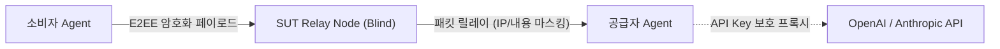

# SUT P2P 네트워크, 브로커 및 DID 아키텍처

> **탈중앙화 P2P 통신, 상호 은닉, 자급자족형 신원(DID), 그리고 브로커 네트워크의 동작 원리**

---

## 1. P2P 네트워킹 및 보안 스택

| 영역 | 채택 기술 | 선정 사유 및 역할 |
| :--- | :--- | :--- |
| **P2P 프레임워크** | **libp2p** | 검증된 모듈형 P2P 스택. NAT 트래버설 및 분산 오버레이 지원 |
| **전송 프로토콜** | **QUIC (UDP 기반)** | 0-RTT 연결 및 Head-of-line blocking 없는 고속 LLM 토큰 스트리밍 |
| **NAT 트래버설** | **AutoNAT + Circuit Relay v2** | 공유기/방화벽 환경에서도 99% P2P 홀펀칭 및 연결 수립 |
| **채널 암호화** | **Noise Protocol (XX 패턴)** | 종단 간(E2EE) 기밀성 보장 (ChaCha20-Poly1305) |

---

## 2. Peer 은닉 및 프라이버시 (Blind Relay)

공급자와 소비자는 서로의 실제 IP 주소나 신원을 알지 못한 채 안전하게 백그라운드에서 통신합니다.



- **블라인드 릴레이 (Blind Relay)**: 직접 IP 노출을 꺼리는 경우, 중계 노드(Relay)를 경유하여 패킷을 마스킹 전달.
- **전송 구간 암호화**: 릴레이 노드는 E2EE 암호화로 인해 프롬프트/응답의 원문을 열람할 수 없음.
- **일회용 세션 키 (Ephemeral Key)**: 거래 세션마다 새로운 키를 생성하여 이전 거래와의 연계 분석(Unlinkability) 원천 차단.
- **실용주의적 한계 인지**: P2P 전송 구간은 완벽히 암호화되나, 최종 요청을 OpenAI로 전송하는 공급자 PC 환경 특성상 프롬프트가 노출될 수 있으므로 **비민감성 데이터(번역, 일반 코딩, 요약 등) 활용을 기본 전제**로 합니다.

---

## 3. DID(탈중앙 신원) 발급 및 검증 원리

> **핵심**: 중앙 발급 기관이 없습니다. **로컬 SUT Agent가 0.01초 만에 자급자족(Self-Issued) 생성**합니다.

### 3.1 발급 메커니즘 (`did:key` 방식)
```text
[SUT Agent 최초 실행]
        │
        ▼ (로컬 난수 생성)
[Ed25519 암호키 쌍 생성] ──► 개인키 (Private Key) : 로컬 PC 내부에만 극비 저장
        │
        ▼ (수학적 도출)
    공개키 (Public Key)   : 0x3aF89c...
        │
        ▼ (W3C did:key 인코딩)
[내 고유 DID 완성]        : did:key:z6MkhaXgBZDvotDkL5257faizti...
```

### 3.2 자체 검증 (Self-Certifying)
- **발급처가 없는데 어떻게 신뢰하는가?**
  - `did:key:z6M...` 문자열 자체가 공개키의 지문(Fingerprint)입니다.
  - Agent가 메시지나 영수증을 보낼 때 **개인키로 전자서명**을 첨부합니다.
  - 상대방은 제3자에게 묻지 않고, **DID에 적힌 공개키로 서명을 수학적으로 검증**하여 사칭을 100% 방지합니다.

---

## 4. Broker의 실체와 운영 인센티브

> **브로커는 중앙 서버가 아닌, 토렌트의 DHT 노드나 블록체인 채굴 노드와 같은 탈중앙 소프트웨어입니다.**

### 4.1 누가 브로커를 띄우는가?
1. **누구나 실행 가능**: `sut --mode broker` 명령으로 누구나 오픈소스 브로커 노드 구동 가능.
2. **고성능 Agent의 자동 승격 (Supernode)**: 네트워크 품질이 좋고 고정 IP를 가진 Agent는 백그라운드에서 임시 브로커 역할을 겸업.
3. **부트스트랩 시드**: 최초 네트워크 진입 시 커뮤니티 공개 시드 노드 3~5개를 활용하며, 이후 Gossip 프로토콜로 전체 브로커 풀을 자동 동기화.

### 4.2 운영 인센티브 (수수료 보상)
- 브로커는 공급자와 소비자를 탐색·매칭해주고 연결을 주선한 대가로, 거래되는 토큰의 **극소량(예: 0.1% ~ 0.5%)의 마이크로 수수료**를 스마트 컨트랙트로부터 자동 배당받습니다.

---

## 5. 네트워크 안정성에 따른 공급 우선 정책 (Priority Routing)

브로커 네트워크는 노드의 실측 품질 점수($R_i$)를 기반으로 배차 우선권을 부여합니다.

$$R_i = w_1(\text{Uptime}) + w_2(\text{Low Ping/TTFT}) + w_3(\text{Success Rate}) - w_4(\text{Timeout Penalty})$$

| 티어 | 품질 기준 | 매칭 우선권 | 주요 배치 대상 |
| :---: | :--- | :--- | :--- |
| **Tier 1 (Premium)** | Uptime 99%+, TTFT < 300ms | **1순위 우선 배차**, 실시간 인터랙티브 챗 | 클라우드 VPS, 초고속 유선망 |
| **Tier 2 (Standard)** | Uptime 90~99%, 정상 응답 | **2순위 배차**, 일반 요청 | 일반 가정용 PC |
| **Tier 3 (Spot/Bulk)** | 지연시간 편차 큼, 잦은 끊김 | **비실시간 배치 작업 전용** (번역, 대량 요약 등) | 모바일/무선 Wi-Fi 환경 |

- **서킷 브레이커 & 자동 Failover**: 스트리밍 중 공급자 노드가 500ms 이상 무응답 시, 대기 중인 예비 Tier 1 노드로 해당 턴을 재요청하고 세션의 배정 피어를 교체합니다. 평상시에는 같은 세션을 같은 피어로 유지(Sticky)합니다. (상세: [동적 턴 단위 피어 스위칭](dynamic-peer-switching.md))
