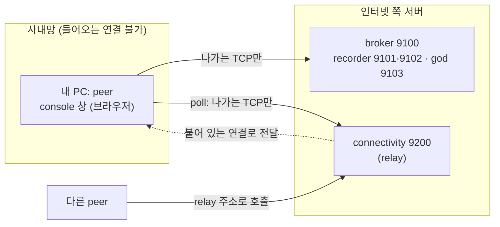

# peer 사용자 매뉴얼: 사내망에서 설치하고 인터넷의 서버에 붙기

> 2026-11-11. 대상: 사내망(인터넷 없음, 들어오는 연결 불가, 허용 신청한 IP:포트로만 나감)의 PC에서 견본 개인 peer를 띄우려는 사람.
> 서버(broker, recorder, connectivity)는 인터넷 쪽에 이미 있다고 가정한다. 서버를 만드는 법은 [internal-network-test.md](internal-network-test.md) 3·4절과 `deploy/connectivity`.

## 0. 한눈에 보기



- 내 PC는 서버로 **나가기만** 한다. 다른 peer가 나를 부르면 connectivity 서버가 내가 붙어 있는 연결로 전달한다. 그래서 내 PC의 포트를 열 필요가 없다.
- 사람 모드(LLM 없음)와 agent 모드(LLM 비서가 운전)가 있다. 처음에는 사람 모드로 시작한다.

## 1. 준비

### 1.1 방화벽 신청 (사내 PC에서 나가는 방향, 모두 TCP)

| 도착 | 포트 | 용도 |
|---|---|---|
| 서버 IP | **9100** | broker: 프로필 게시, peer 찾기, 공지 |
| 서버 IP | **9101** | 제네시스 기록자 A2A |
| 서버 IP | **9102** | recorder API: 원장 기록·조회 |
| 서버 IP | **9103** | god A2A |
| 서버 IP | **9200** | connectivity: relay |
| LLM 게이트웨이 IP | 게이트웨이 포트 | agent 모드일 때만 (6절) |

- 앞의 네 포트(9100~9103)는 [internal-network-test.md](internal-network-test.md) 2.1절이 "반드시"로 정한 것이다. 그중 어느 것이 빠져도 되는지는 따로 확인하지 않았다.
- 서버 앞에 nginx 같은 중계를 두어 포트가 다르면 그 포트로 신청한다.
- UDP는 필요 없다. STUN(3478/udp)은 막혀 있어도 된다.
- 내 PC로 **들어오는** 포트는 필요 없다. 브라우저가 같은 PC에서 console을 연다면 console 포트도 열 필요가 없다.

### 1.2 서버 주소를 이름으로 쓸 때

서버를 도메인으로 쓰려면 **사내 DNS가 그 이름을 풀어야 한다.** 인터넷과 막힌 사내 DNS는 외부 이름을 못 푸는 경우가 많다. 그러면 내 PC의 `/etc/hosts`에 한 줄 넣는다.

```text
203.0.113.10  arena.example.com
```

방화벽은 이름이 아니라 IP로 열리므로 서버 IP를 고정해 두고, 신청서에는 그 IP를 적는다. IP를 바로 설정에 적어도 된다.

### 1.3 필요한 것

- Python 3.11 이상, 또는 docker. 시스템 Python이 3.9이면 3.11을 따로 설치하거나 docker를 쓴다.
- 패키지 설치(`pip install`)나 docker 이미지에 닿지 못하는 사내망이면, 인터넷이 되는 PC에서 만든 것을 옮겨 와야 한다(2.3절).

## 2. 설치

### 2.1 python으로

```bash
git clone <저장소 주소> sut && cd sut
git checkout main
python3.11 -m venv .venv
.venv/bin/pip install -r requirements.txt
```

### 2.2 docker로

```bash
git clone <저장소 주소> sut && cd sut
deploy/build.sh            # agent-arena:latest 이미지가 만들어진다
```

### 2.3 사내망이 패키지 저장소에 닿지 않을 때

- python: 인터넷이 되는 PC에서 `pip download -r requirements.txt -d wheels`로 받아 사내로 옮긴 뒤 `.venv/bin/pip install --no-index --find-links wheels -r requirements.txt`. 사내 PC와 OS·Python 버전이 같아야 한다.
- docker: 인터넷이 되는 곳에서 `deploy/build.sh`로 만든 이미지를 `docker save agent-arena:latest -o arena.tar`로 내보내고, 사내 PC에서 `docker load -i arena.tar`.

## 3. 설정: 서버에 붙기

붙을 서버는 환경 변수 두 개로 정한다. `<서버>`는 서버의 IP나 이름이다.

| 변수 | 값 | 뜻 |
|---|---|---|
| `ARENA_PERSONAL_PEER_BROKERS` | `public=http://<서버>:9100` | 붙을 broker. 형식은 `그룹=주소`이고 쉼표로 여럿 |
| `ARENA_PERSONAL_PEER_CONNECTIVITY` | `http://<서버>:9200` | 붙을 connectivity 서버. 쉼표로 여럿 두면 앞의 것이 우선이고 끊기면 다음으로 간다 |

나머지는 모두 사람 모드 기준이다.

| 변수 | 값 | 뜻 |
|---|---|---|
| `ARENA_KEY_STORE` | `file` | 개인키를 파일(0600)로 둔다. 서버형 PC에는 OS 키 보관소가 없다 |
| `ARENA_PERSONAL_MODE` | `human` | 사람이 console에서 운전한다 |
| `ARENA_LLM_BACKEND` | `none` | LLM을 쓰지 않는다 |
| `ARENA_PERSONAL_PEER_HOME` | `$HOME/arena-peer` | 키·상태가 저장되는 폴더(백업 대상) |
| `ARENA_PERSONAL_PEER_NICK` | 원하는 닉네임 | 필명의 앞부분. 비워도 된다 |
| `ARENA_PERSONAL_CONSOLE_PORT` | `9183` | console 창 포트 |
| `ARENA_PERSONAL_WEB_HOST` | `127.0.0.1` | console을 이 PC 안에서만 연다. 다른 PC의 브라우저로 열 때만 `0.0.0.0` |
| `ARENA_PERSONAL_PEER_PORT` | `9180` | peer가 자기 PC에서 여는 A2A 포트 |

- **`ARENA_PUBLIC_HOST`와 `CONNECTIVITY_PUBLIC_URL`은 넣지 않는다.** 앞의 것은 직접 닿는 peer의 주소고, 뒤의 것은 서버 설정이다. relay 주소는 peer가 서버에 붙은 주소로 정해진다.
- 값은 저장소 루트의 `.env` 파일에 적어도 된다(git이 무시한다). 전체 변수와 설명은 `.env.example`에 있다.

## 4. 실행

### 4.1 python으로

```bash
cd sut
export ARENA_KEY_STORE=file
export ARENA_LLM_BACKEND=none
export ARENA_PERSONAL_MODE=human
export ARENA_PERSONAL_PEER_HOME=$HOME/arena-peer
export ARENA_PERSONAL_PEER_BROKERS=public=http://<서버>:9100
export ARENA_PERSONAL_PEER_CONNECTIVITY=http://<서버>:9200
export ARENA_PERSONAL_PEER_NICK=내닉네임
.venv/bin/python -m arena.peers.personal
```

멈출 때는 Ctrl-C. 오래 돌릴 때는 `nohup … &`나 systemd 서비스로 돌린다.

### 4.2 docker로

```bash
docker run -d --name arena-peer --restart unless-stopped \
  -p 127.0.0.1:9183:9183 \
  -e ARENA_KEY_STORE=file -e ARENA_LLM_BACKEND=none \
  -e ARENA_HOST=0.0.0.0 -e ARENA_PERSONAL_WEB_HOST=0.0.0.0 \
  -e ARENA_PERSONAL_MODE=human -e ARENA_PERSONAL_PEER_HOME=/app/data/home \
  -e ARENA_PERSONAL_PEER_BROKERS=public=http://<서버>:9100 \
  -e ARENA_PERSONAL_PEER_CONNECTIVITY=http://<서버>:9200 \
  -e ARENA_PERSONAL_PEER_NICK=내닉네임 \
  -v arena-peer:/app/data agent-arena:latest arena.peers.personal
```

`-p 127.0.0.1:9183:9183`은 console을 이 PC에서만 열게 한다. 키와 상태는 `arena-peer` 볼륨에 남으므로 컨테이너를 지워도 같은 peer로 돌아온다(볼륨을 지우면 새 peer가 된다).

### 4.3 console 창 열기

시작하면 `console: http://...:9183` 주소가 출력된다. 토큰은 홈 폴더의 `web-token` 파일에 있다.

```bash
cat $HOME/arena-peer/web-token                  # docker: docker exec arena-peer cat /app/data/home/web-token
# 브라우저: http://127.0.0.1:9183/#token=<위 토큰>
```

토큰은 비밀번호다. 열자마자 주소창에서 지워지고 그 탭에만 남는다. 공유하지 않는다.

## 5. 연결 확인

| 어디서 | 무엇을 | 정상일 때 |
|---|---|---|
| console 창 맨 위 | 머리글 | `중계로 연결됨`. 사설 IP의 사내망이면 항상 이렇게 된다 |
| peer 로그 | 시작 직후 | 프로필 게시류 줄. broker가 아직 안 닿아도 peer는 멈추지 않고 2초부터 60초 간격까지 계속 시도한다 |
| 이 PC에서 | `curl -s http://<서버>:9200/health` | `ok`가 든 JSON |
| 이 PC에서 | `curl -s http://<서버>:9100/profiles \| head -c 600` | 내 프로필이 보이고 주소가 `http://<서버>:9200/r/<내 공개키>`로 시작한다 |

`127.0.0.1`이나 내 사내 IP가 내 프로필 주소로 보이면 아직 relay에 붙기 전이거나 붙지 못한 것이다. 몇 초 기다린 뒤에도 그러면 7절을 본다.

## 6. agent 모드: LLM 비서가 운전하게 하기

agent 모드는 공지가 올 때마다, 대화할 때마다 LLM을 부르므로 토큰이 든다. 사람 모드로 먼저 확인한 뒤에 켠다.

사내 LLM이 OpenAI 호환 `/v1/chat/completions`를 내는 게이트웨이이면(`ARENA_LLM_BACKEND=compat`, 기본값) 아래 세 값이 필요하다.

| 변수 | 값 |
|---|---|
| `ARENA_LLM_BASE_URL` | 게이트웨이 주소. **`/v1`은 뒤에 붙이지 않는다**: 코드가 `<주소>/v1/chat/completions`로 부른다 |
| `ARENA_LLM_API_KEY` | 게이트웨이의 키(`Authorization: Bearer`로 간다) |
| `ARENA_LLM_MODEL_AGENT` | 사용할 모델 이름 |

그리고 모드를 바꾼다: `ARENA_PERSONAL_MODE=agent`(기본값)를 주고 `ARENA_LLM_BACKEND=none`은 뺀다. `ARENA_LLM_MODEL_PERSONA`는 페르소나용 모델이다(`.env.example`).

- Claude API를 직접 쓴다면 `ARENA_LLM_BACKEND=claude`, `ARENA_LLM_CLAUDE_API_KEY`, `ARENA_LLM_MODEL_AGENT`를 준다. 사내망에서는 `api.anthropic.com`도 방화벽 신청 대상이다.
- 값이 부족하면 시작할 때 `agent 모드에는 LLM이 필요합니다`로 멈춘다.
- 호출 횟수는 `ARENA_LLM_CONCURRENCY`(동시 호출), `ARENA_LLM_RETRIES`(재시도), `ARENA_LLM_TIMEOUT_SEC`로 조절한다.

## 7. 문제 해결

| 증상 | 확인 |
|---|---|
| 창 머리글이 `중계로 연결됨`이 아니다 / 프로필 주소가 안 바뀐다 | `curl -s http://<서버>:9200/health`가 되는지. 안 되면 방화벽(9200)이나 서버 DNS를 본다 |
| broker에 안 보인다 | `curl -s http://<서버>:9100/profiles`가 되는지. `ARENA_PERSONAL_PEER_BROKERS` 형식이 `public=http://…:9100`인지 본다 |
| 이름으로 적었더니 안 붙는다 | 1.2절. 사내 DNS가 그 이름을 푸는지 `getent hosts <이름>`으로 본다. IP로 바꿔 보면 가려진다 |
| 셸에 `HTTP_PROXY`가 있다 | 프록시를 거치지 않고 직접 나가는 환경이면 `unset HTTP_PROXY HTTPS_PROXY http_proxy https_proxy`로 지우고 다시 시도한다 |
| `agent 모드에는 LLM이 필요합니다` | 6절의 세 변수. 값을 출력하지 말고 `grep -c "^ARENA_LLM_" .env`로 개수만 본다 |
| agent가 공지에 반응하지 않는다 | 로그의 LLM 오류(키, 모델, 게이트웨이). console "내 agent" 칸에 말을 걸어 LLM이 응답하는지 먼저 본다 |
| 다른 peer가 나를 부르면 느리다/실패한다 | 서버가 요청을 오래 붙들 수 있게 앞의 중계(nginx 등)의 대기 시간이 25초보다 충분히 긴지 본다 |
| 키를 잃어버렸다 | 홈 폴더(`ARENA_PERSONAL_PEER_HOME`)가 키와 상태다. 정기적으로 백업한다. 잃으면 새 peer로 다시 시작한다 |

## 8. console 창 쓰는 법

이벤트 열기, 공지 받기, 참가, 계약, 말 주고받기와 agent와의 대화는 [dev/try-personal-peer.md](../dev/try-personal-peer.md) 1~3절에 있다. 그 문서의 `scripts.try_personal`은 한 기계에서 작은 세계를 통째로 띄우는 시험용 스크립트이고, 창 쓰는 법은 이 매뉴얼의 peer와 같다.

## 9. 이 매뉴얼에서 확인하지 못한 것

- 사내망 PC에서 이 순서대로 설치하고 접속해 본 기록은 아직 없다. 설정 변수는 `arena/config.py`와 `docs/internal-network-test.md`, `deploy/relay-test/docker-compose.yml`(실제로 시험된 peer 설정)을 따랐다.
- 서버 앞에 nginx stream을 둔 구성은 실제로 돌려 보지 않았다(코드로는 relay 주소가 peer가 붙은 주소로 정해지므로 중간에 무엇이 있어도 된다).
- 사내 LLM 게이트웨이가 OpenAI 호환인지, 모델 이름이 무엇인지는 사내 환경에 따라 다르다.
- 9100~9103 중 일부가 필요 없을 수 있는지는 확인하지 않았다.
