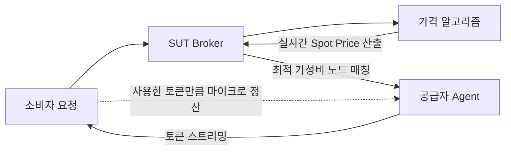

# SUT 토큰 자동 가격 결정 메커니즘 (Pricing Mechanism)

> **핵심 원칙**: 공급자와 소비자 모두 수동 설정 없이(Zero-Config), 네트워크 상태, 공급 유형별 소멸 위험, 노드 품질에 따라 알고리즘이 실시간 자동 산출합니다.

---

## 1. 핵심 가격 공식

특정 노드 $i$가 제공하는 특정 모델의 실시간 토큰 단가 $P_t(i)$는 다음 공식으로 계산됩니다.

$$P_t(i) = P_{\text{official}} \times \alpha_{\text{base}} \times \Phi(U_t) \times \Psi(\Delta t_i) \times \Omega(Q_i)$$

$$\text{단, } P_{\text{floor}} \le P_t(i) \le P_{\text{ceiling}} \quad (P_{\text{ceiling}} = 0.90 \times P_{\text{official}})$$

---

## 2. 변수 및 조절 요인 요약

| 변수 | 명칭 | 기본값 / 범위 | 설명 및 역할 |
| :--- | :--- | :--- | :--- |
| **$P_{\text{official}}$** | 공식 기준가 | 모델별 상이 | 상용 API는 OpenAI/Anthropic의 공식 API 가격, 로컬 오픈 모델은 같은 모델의 호스팅 API 시세 (Oracle 연동) |
| **$\alpha_{\text{base}}$** | 기본 할인율 | `0.70` (30% 할인) | 플랫폼의 기본 출발 기준선 |
| **$\Phi(U_t)$** | 수요·공급 지수 | `0.8 ~ 1.2` | 네트워크 가동률($\text{수요}/\text{공급}$)에 따른 탄력적 변동 |
| **$\Psi(\Delta t_i)$** | 소멸 위험 계수 | `0.4 ~ 1.0` | 공급 자원이 실제로 소멸하는 경우(선불 크레딧 만료, 로컬 GPU 유휴 시간)에만 적용하는 할인. 후불 API는 항상 `1.0` |
| **$\Omega(Q_i)$** | 품질(QoS) 가중치 | `0.85 ~ 1.1` | 실측 응답속도(TTFT, TPS) 및 에러율 기반 보정 |

---

## 3. 4대 세부 동작 원리

### ① 기준 가격 (Anchor & Base Discount)
- 공식 API 가격($P_{\text{official}}$)을 앵커로 삼고 기본 30% 할인($\alpha_{\text{base}} = 0.70$)을 적용합니다.
- **상한선($P_{\text{ceiling}}$)**: 어떤 경우에도 공식 가격의 90%를 초과하지 않아 소비자의 가격 우위를 항상 보장합니다.

### ② 실시간 수요·공급 조절 ($\Phi(U_t)$)
- **가동률($U_t$) = 현재 요청량 / 전체 대기 공급량** (목표 가동률 $U^* = 60\%$)
- 공급 과잉 ($U_t < 60\%$): 단가를 점진적으로 인하하여 수요 유치.
- 수요 폭증 ($U_t > 60\%$): 단가를 소폭 인상하여 신규 공급자 유인 및 트래픽 분산.

### ③ 소멸 위험 감가 ($\Psi(\Delta t_i)$)

공급 자원이 **쓰지 않으면 실제로 사라지는 경우에만** 할인을 적용합니다. $\Delta t_i$는 노드 $i$의 공급 자원이 소멸하기까지 남은 시간입니다.

| 공급 유형 | 소멸 여부 | $\Delta t_i$의 의미 | $\Psi$ 적용 |
| :--- | :--- | :--- | :--- |
| **후불 API 키** (사용량 과금) | 소멸 없음. 쓰지 않은 예산은 돈이 나가지 않은 것일 뿐 | 해당 없음 | 항상 `1.0` |
| **선불 API 크레딧** | 소멸함 (예: OpenAI 선불 크레딧은 구매 후 1년 뒤 소멸) | 크레딧 만료일까지 남은 시간 | 만료 30일 이상 `1.0` → 7일 이내 점진 감가 → 24시간 이내 `0.4 ~ 0.5`. **만료 예정 잔액 한도 안에서만** 적용 |
| **로컬 GPU** (오픈 모델) | 소멸함. 유휴 GPU 시간은 저장해 둘 수 없음 | 현재 유휴 시간대가 끝나기까지 남은 시간 (공급자가 설정한 판매 가능 시간대 기준) | 노드 유휴율에 따라 `0.6 ~ 1.0` |

- **검증 불필요**: $\Psi$는 공급자가 **자기 가격을 낮추는** 방향으로만 작동하므로, 공급자가 신고한 만료일이나 유휴 상태를 브로커가 검증하지 않아도 소비자에게 불리한 조작 유인이 없습니다.
- **비중에 대한 주의**: 선불 크레딧 만료는 1년 주기라 자주 일어나지 않습니다. 따라서 $\Psi$는 가격의 주된 동인이 아니라 보조 계수이며, 실제 단가는 주로 $\Phi$(수요·공급)와 $\Omega$(품질)로 결정됩니다.

### ④ 노드 품질 보정 ($\Omega(Q_i)$)
- 브로커와 소비자가 측정한 실측 QoS 데이터로 자동 보정합니다.
- **초고속 저지연 노드** (낮은 TTFT, 높은 TPS): +5~10% 프리미엄.
- **불안정한 홈 네트워크** (높은 지연, 간헐적 지연): -15~30% 추가 할인.

---

## 4. 시나리오별 실시간 가격 예시

> 기준: 공식 입력 단가가 **\$2.50 / 1M Input Tokens**인 가상의 모델 ($P_{\text{official}}$). 실제 운영 시에는 각 사 공식 가격표를 Oracle로 연동합니다.

| 상황 | 가동률 ($U_t$) | 공급 유형 / 소멸 시점 ($\Delta t_i$) | 노드 품질 ($Q_i$) | 최종 단가 (1M 토큰당) | 공식가 대비 |
| :--- | :---: | :---: | :---: | :---: | :---: |
| **표준 상태** | 보통 (60%) | 후불 API (소멸 없음, $\Psi = 1.0$) | 표준 노드 | **\$1.75** | **30% 저렴** |
| **네트워크 공급 과잉** | 저조 (25%) | 후불 API (소멸 없음, $\Psi = 1.0$) | 표준 노드 | **\$1.40** | **44% 저렴** |
| **선불 크레딧 만료 임박** | 보통 (60%) | 선불 크레딧, 만료 12시간 전 ($\Psi = 0.5$) | 표준 노드 | **\$0.88** | **65% 저렴** |
| **로컬 GPU 유휴 시간대** | 보통 (60%) | 로컬 GPU, 유휴 ($\Psi = 0.7$) | 표준 노드 | **\$1.23** | **51% 저렴** |
| **프리미엄 노드** | 높음 (80%) | 후불 API (소멸 없음, $\Psi = 1.0$) | 초고속 광랜 | **\$2.05** | **18% 저렴** |

> 로컬 GPU 행은 같은 오픈 모델의 호스팅 API 시세가 \$2.50이라고 가정한 예시입니다.

---

## 5. 자동 매칭 및 결제 흐름

1. **소비자 요청**: 모델 선택 및 최대 예산 조건 전달.
2. **알고리즘 산출**: Broker가 현재 네트워크 지표를 바탕으로 가용 노드별 실시간 Spot Price 계산.
3. **자동 매칭**: 최저가 또는 소비자의 선호(속도 우선 vs 가격 우선)에 맞는 최적 노드 즉시 연결.
4. **마이크로 정산**: 스트리밍 완료 후 실제 소비된 토큰만큼 실시간 결제.
