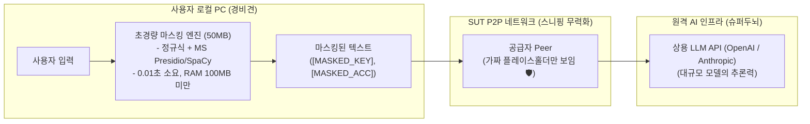
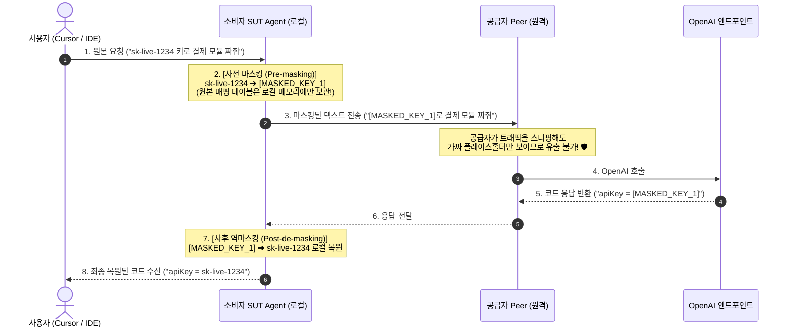
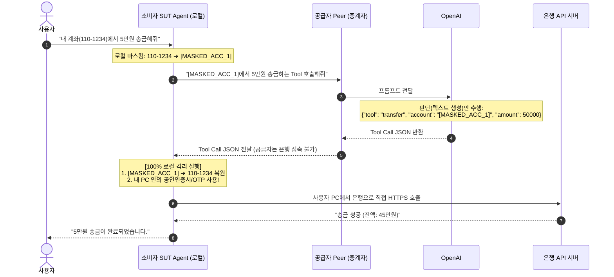

# SUT 로컬 프라이버시 보호 및 안전한 툴 콜링 (Privacy & Safe Tool Calling)

> **로컬 초경량 마스킹 파이프라인과 금융/상거래 툴 콜링(Tool Calling)의 안전한 로컬 격리 실행 메커니즘**

---

## 1. 프라이버시 보호 핵심 원칙: "로컬 경비견과 원격 슈퍼두뇌"

복잡한 코딩과 고난도 추론은 원격 Peer의 거대 LLM(OpenAI, Anthropic 등의 상용 API 모델)을 빌려 쓰지만, **민감 정보 감지 및 마스킹은 사용자 로컬 PC의 50MB 초경량 엔진(경비견)이 전담**합니다.

---

## 2. 왜 로컬에 똑똑한 거대 LLM이 필요 없는가?

"생성(Generation)"과 "감지(Detection)"의 연산량 차이 때문입니다.

| 구분 | 로컬 SUT Agent (마스킹 경비견) | 원격 공급자 Peer (AI 슈퍼두뇌) |
| :--- | :--- | :--- |
| **수행 작업** | 이미 쓰여진 텍스트에서 민감 정보 밑줄 긋기 | 논리 추론, 코드 생성, 심층 분석 창작 |
| **필요 모델 크기** | **50MB ~ 100MB (규칙 + 초경량 NER)** | **대규모 (상용 모델은 크기 비공개, 데이터센터 GPU에서 서빙)** |
| **요구 하드웨어** | 일반 사무용 노트북 CPU (RAM 100MB) | 수천만 원대 데이터센터 GPU |
| **소요 시간** | **0.01초 미만 (체감 불가)** | 수 초 단위 스트리밍 |

### 현업 표준 3단계 초경량 마스킹 스택
1. **1단계: 규칙 및 체크섬 알고리즘 (0.001초, RAM 1MB)**:
   - **API Key**: `sk-[a-zA-Z0-9]{48}`, `ghp_...` (정규식 1줄로 100% 탐지)
   - **주민번호, 전화번호, 이메일, 신용카드 번호**: 자릿수 및 룬(Luhn) 알고리즘으로 검증 탐지
2. **2단계: 초경량 자연어 NER 엔진 (0.01초, RAM 50~100MB)**:
   - **Microsoft Presidio + SpaCy**: 마이크로소프트의 오픈소스 표준 도구. 거대 모델 없이도 문맥 속 인명, 회사명, 주소를 정확히 라벨링.
3. **3단계: (선택) 초소형 SLM (RAM 300MB)**:
   - 더 정교한 문맥 마스킹이 필요할 경우 `SmolLM2-135M` 또는 `Qwen2.5-0.5B`를 로컬 백그라운드 구동.

---

## 3. 사전 마스킹 & 사후 역마스킹 (Pre-Masking & Post-De-masking)

---

## 4. 은행 및 상거래 툴 콜링(Tool Calling)의 안전성

> **핵심 원리: "LLM은 실행하지 않고, 판단(JSON 생성)만 한다."**

LLM이나 중간 공급자 Peer는 사용자의 은행이나 쇼핑몰에 직접 접속할 권한도 없고, 기술적으로 접속할 수도 없습니다.

### 공급자 Peer에게 절대 전달되지 않는 정보
1. **금융 인증서 및 비밀번호**: 공인인증서, OTP, 결제 토큰은 공급자 PC를 전혀 거치지 않고 사용자 PC에만 존재.
2. **실제 계좌번호 및 주민번호**: 네트워크 구간에서는 `[MASKED_ACC_1]` 같은 가짜 토큰으로 마스킹되어 전송.
3. **최종 금융 트랜잭션 결과 원문**: 은행 서버와 사용자 PC 간의 직접 암호화 통신으로 격리 보호.

---

## 5. 결론

SUT 플랫폼을 통해 다른 Peer가 공유한 토큰을 쓰더라도:
- **추론(머리)**만 원격 Peer의 상용 LLM을 빌려 쓰는 것이며,
- **보안 검문(마스킹)과 실제 금융 실행(손발)**은 **사용자의 로컬 PC 내부에서 100% 프라이빗하게 격리 완결**되므로 민감 정보 유출 위험이 원천 차단됩니다.
