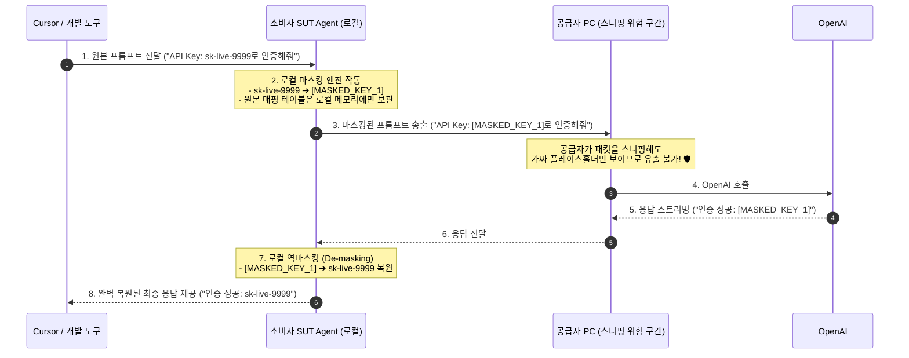
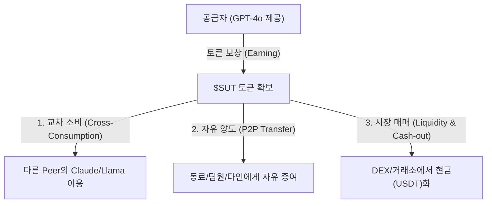

# Share-Ur-Tokens (SUT) 시스템 개요 및 아키텍처

> **탈중앙화 P2P LLM 토큰 공유 및 거래 네트워크**  
> 사용하지 않는 개인의 LLM 구독/API 토큰을 공유·판매하고, 필요한 사용자는 구독 없이 필요한 만큼 종량제로 안전하게 구매할 수 있는 무신뢰(Trustless) 분산 플랫폼입니다.

---

## 1. 프로젝트 비전 및 배경

### 1.1 배경 및 문제 정의
- **잔여 토큰 낭비**: 많은 사용자가 ChatGPT Plus, Claude Pro, OpenAI/Anthropic API 등 다양한 LLM 서비스를 월정액 또는 선불 크레딧으로 구독하지만, 매월 제공량을 전부 소진하지 못하고 버려지는 경우가 많습니다.
- **높은 구독 진입 장벽**: 간헐적으로 고성능 LLM 모델(GPT-4o, Claude 3.5 Sonnet 등)이 필요한 사용자는 비싼 월 구독료를 지불하기 부담스럽습니다.
- **중앙화 플랫폼의 한계**: 기존의 중앙화 중계 서비스는 마진 수수료, 개인정보(프롬프트) 검열, 중앙 서버 단일 장애점(SPOF), 그리고 API Key 유출 위험이 존재합니다.

### 1.2 핵심 가치 (Value Proposition)
- **공급자 (Provider/Seller)**: 쓰고 남은 유휴 LLM 토큰을 시장에 판매하여 비용을 회수하고 수익화.
- **소비자 (Consumer/Buyer)**: 비싼 월 구독 없이, 원하는 모델을 필요한 토큰 단위로 저렴하게 이용.
- **빅테크 추적 회피 (Anti-Tracking & Privacy Sovereignty)**: 실제 사용자는 빅테크(OpenAI 등) 입장에서 '유령'이 되며, 질문이 여러 공급자 노드로 분산되어 개인의 관심사·지적 활동이 빅데이터로 수집/프로파일링되는 것을 원천 차단 (DuckDuckGo/Tor 효과).
- **P2P & 무신뢰(Trustless)**: 중앙 서버 없이 Broker 네트워크와 탈중앙 분산 원장(Decentralized Ledger)을 통해 완전 자동화된 매칭 및 정산 수행.
- **P2P 한계를 무력화하는 무상태(Stateless) 내결함성**: 장시간 연결 유지가 필요한 기존 P2P와 달리, 단 3초 단위의 무상태 마이크로 태스크와 클라이언트 측 대화 기억(Context) 관리로 피어의 잦은 이탈(Churn)에도 100% 무중단 연속 대화 보장 (Zero-Downtime Failover).
- **익명성 및 보안**: Peer 간에는 서로의 신원이나 원본 API Key를 알지 못한 채 안전한 백그라운드 터널링으로 통신.

---

## 2. 시스템 핵심 구성 요소 (Core Components)

```mermaid
flowchart TB
    subgraph Client_App["Open AI Agents & IDEs (User Interface)"]
        Cursor["Cursor / Cline / Continue / OpenWebUI"]
    end

    subgraph Consumer_Node["Consumer (Buyer) Local Environment"]
        CA["SUT Agent (localhost:8080/v1 Gateway)"]
    end

    subgraph Broker_Network["SUT Broker Network (Distributed Overlay)"]
        B1["SUT Broker A"] <--> B2["SUT Broker B"]
    end

    subgraph Provider_Node["Provider (Seller) SUT Agent"]
        PA["SUT Agent (Reverse Proxy)"]
        PA -->|"Private API Key"| LLM["Upstream LLM Service (OpenAI, Anthropic, etc.)"]
    end

    subgraph Ledger_Layer["Decentralized Ledger / Blockchain"]
        SC["Smart Contract & Escrow / Token Settlement"]
    end

    Cursor ==="Standard OpenAI API (Transparent)"===> CA
    PA -.->|"1. Register Profile & Capacity"| B1
    CA -.->|"2. Lookup & Match Request"| B2
    CA ==="3. P2P Encrypted Proxy Request (Blind Tunnel)"===> PA
    PA -.->|"4. Report Usage & Proof"| SC
    CA -.->|"4. Verify & Settle"| SC
```

### 2.1 SUT Agent
개인 사용자가 로컬 머신 또는 개인 서버에 설치하는 경량 백그라운드 데몬/클라이언트입니다. 특정 전용 UI에 종속된 폐쇄형 구조가 아니며, **로컬 HTTP 게이트웨이, 표준 입출력(stdin/stdout) IPC, 플러그인 확장** 등 다양한 방식으로 로컬의 모든 오픈형 AI 에이전트와 유연하게 결합됩니다.

- **다양한 로컬 프로세스 연동 인터페이스 (Multi-Interface Connectivity)**:
  1. **HTTP/REST 게이트웨이 모드**:
     - 로컬에 `http://localhost:8080/v1` (OpenAI/Anthropic 표준 호환) 엔드포인트 제공.
     - **Cursor, Continue.dev, Cline, OpenWebUI** 등의 설정에서 Base URL만 변경하여 즉시 사용.
  2. **표준 입출력 (stdin / stdout) IPC & MCP 모드**:
     - 포트 충돌이나 네트워크 소켓 오버헤드 없이, 프로세스 간 파이프(Pipe)를 통해 고속 스트리밍 데이터 교환.
     - **MCP (Model Context Protocol)** 지원: `stdio` 기반 JSON-RPC 통신을 통해 Claude Desktop, Cursor 등의 네이티브 Tool/Resource로 직접 플러그인 등록 가능.
     - 터미널 CLI 파이프라인 지원 (`cat prompt.txt | sut-agent run --model gpt-4o | output.txt`).
  3. **네이티브 플러그인 / 익스텐션 모드 (Plugin Mode)**:
     - VS Code, Cursor 등의 Extension/Plugin 형태로 패키징되어, 별도 설치 없이 IDE 백그라운드 서브프로세스로 자동 실행 및 생명주기 관리.

- **제공자 모드 (Provider Mode)**:
  - 사용자가 업스트림 LLM 엔드포인트(예: OpenAI, Anthropic, Ollama 등)와 API Key를 로컬 환경설정에 등록.
  - SUT Agent가 해당 엔드포인트의 유효성, 지원 모델(Context window, RPM/TPM 등)을 검증하여 **검증된 프로필(Verifiable Profile)** 자동 생성.
  - 제공자는 판매할 최대 토큰 한도(Limit), 시간대, 허용 모델, 단가 등을 직접 지정.
  - 외부로 API Key를 절대 유출하지 않고, 인입된 요청을 로컬에서 대신 호출해 주는 **Reverse Proxy** 역할 수행.

- **소비자 모드 (Consumer Mode)**:
  - 로컬 포트(`localhost:8080`)로 들어오는 프롬프트 요청을 가로채, Broker 네트워크를 통해 조건(모델, 지연시간, 예산)에 맞는 최적의 공급자 Peer를 즉시 매칭하고 E2EE P2P 터널로 연결.
  - **로컬 자동 마스킹 엔진 (Data Sanitizer)**: 프롬프트에 포함된 API Key나 개인정보(이메일, 전화번호 등)를 감지하여 네트워크 송출 전 가짜 플레이스홀더(`[MASKED_KEY]`)로 자동 치환하고, LLM 응답 수신 시 원래 값으로 자동 복원(De-masking).

- **보안 및 측정 모듈**:
  - 입출력 토큰(Token Count)을 실시간 파싱 및 정량화.
  - 암호학적 서명(Signed Attestation)을 생성하여 사용량 증명 발행.

### 2.2 SUT Broker Network
P2P 디스커버리(Discovery) 및 매칭을 담당하는 분산형 브로커 노드 네트워크입니다.
- **분산 오버레이 (Distributed DHT / Gossip)**:
  - 중앙 서버 없이 분산된 복수의 SUT Broker가 상호 연결되어 노드 및 가용 리소스 풀을 동기화.
  - Agent는 지연시간(RTT)이 가장 가까운 인접 브로커에 자동 연결 및 헬스체크 등록.
- **프로필 레지스트리 (Service Registry)**:
  - 각 Agent가 제공할 수 있는 LLM 스펙, 가용 토큰량, 신뢰도 점수(Reputation)를 인덱싱.
  - Agent 스스로 프로필 스펙을 허위 조작할 수 없도록 초기 핑/검증 챌린지 프로토콜 적용.
- **스마트 매칭 엔진**:
  - 소비자의 요구 조건(모델 종류, 필요 토큰량, 예산)에 부합하는 최적의 단일 또는 복수(Multi-peer fallback) 공급자 Agent를 탐색하여 P2P 핸드셰이크 주선.

### 2.3 탈중앙화 원장 (Decentralized Ledger & Settlement)
신뢰 기관 없이도 사용량과 정산의 무결성을 보장하는 블록체인/레이어2 인프라입니다.
- **에스크로(Escrow) 기반 마이크로페이먼트**:
  - 소비자는 요청 전 일정 금액의 크레딧/토큰을 스마트 컨트랙트 또는 상태 채널(State Channels)에 에스크로 예치.
  - 스트리밍 방식으로 청구되거나, 세션 완료 후 실제 소비된 토큰만큼 공급자에게 지급.
- **사용량 기록 및 영수증 (Proof of Usage)**:
  - 완료된 프롬프트/응답 토큰 수량을 상호 서명(Dual Signature)하여 원장에 기록.
  - 분쟁(Dispute) 발생 시 챌린지 검증 로직 제공.

---

## 3. 핵심 워크플로우 (Workflows)

### 3.1 공급자 (Token Provider) 등록
1. 사용자가 SUT Agent를 실행하고 OpenAI API Key 및 일일 판매 한도(예: 500,000 토큰)를 설정.
2. SUT Agent가 자체 테스트 호출을 통해 모델 티어 및 응답성을 확인.
3. 변조 불가능한 프로필 해시(Profile Digest)를 생성하여 인접 SUT Broker에 등록.
4. Broker 네트워크 전역으로 프로필 메타데이터가 전파되어 대기 상태(Standby)로 전환.

### 3.2 소비자 (Token Consumer) 매칭 및 연결
1. 소비자는 SUT Agent에 원하는 조건(예: `gpt-4o`, 최대 10,000 토큰, max price)을 입력.
2. 소비자 Agent가 Broker 네트워크를 통해 조건에 부합하는 공급자 Agent 후보군을 질의.
3. Broker는 매칭된 공급자 노드의 P2P 연결 정보(ICE/STUN/TURN 기반 주소)를 전달.
4. 양자 간에 직접 엔드투엔드 암호화 터널(E2EE P2P Tunnel)이 수립됨.

### 3.3 백그라운드 트랜잭션 및 LLM 요청 처리
1. 소비자의 프롬프트 요청이 암호화 터널을 통해 공급자의 SUT Agent로 전달.
2. 공급자 Agent는 프롬프트를 자신의 업스트림 LLM(OpenAI 등)으로 포워딩.
3. 응답 스트림이 소비자의 Agent로 실시간 릴레이.
4. 요청 완료 후, 양측 Agent는 송수신된 실제 토큰 수를 계산하고 사용량 티켓에 서명.
5. 오프체인 상태 채널 또는 롤업 레이어에 정산 트랜잭션이 제출되어 정산 완료.

---

## 4. 프라이버시 및 실용주의적 보안 철학 (Pragmatic Security Philosophy)

> **투명한 트레이드오프(Trade-off) 고지**:  
> SUT는 불필요한 구독료 없이 저렴하게 LLM을 종량제로 쓰는 **실용성 중심 플랫폼**입니다. 전송 구간은 암호화되지만, **최종 프록시를 수행하는 공급자 PC 환경에 프롬프트가 노출될 수 있는 기술적 한계를 투명하게 인정**하고 이에 맞는 적합한 유즈케이스를 정의합니다.

### 4.1 핵심 보안 및 보호 영역

| 항목 | 보안 목표 | SUT 기술 메커니즘 |
| :--- | :--- | :--- |
| **API Key 보호** | 타인에게 API Key 노출 원천 차단 | 공급자 Agent 로컬 내부에만 암호화 보관되며, 프록시 요청만 처리 (외부 유출 불가) |
| **P2P 전송 보안** | 제3자 및 ISP 도청 방지 | libp2p QUIC + Noise Protocol 기반 엔드투엔드(E2EE) 암호화 터널 적용 |
| **토큰 카운트 부정** | 소비 토큰 과대/과소 청구 방지 | 표준 토크나이저(Tiktoken) 상호 검증 및 블록체인 상태 채널 서명 정산 |
| **프로필 조작 방지** | 가짜 성능/모델 등록 시도 차단 | Broker의 핑/벤치마크 챌린지 및 신뢰도/스테이킹 메커니즘 |

### 4.2 컨텍스트 노출에 대한 실용적 한계와 사용 가이드라인

공급자는 자신의 PC에서 최고 권한(Root/Admin)을 가지므로, 소프트웨어적으로 프롬프트의 완전한 은닉은 불가능합니다. 그러나 **대부분의 일상적 AI 활용은 컨텍스트가 외부에 노출되어도 무방한 비민감 데이터**이므로 SUT의 실용적 가치는 매우 큽니다.

- **권장 유즈케이스 (SUT 사용 최적)**:
  - 개인 개발 공부, 오픈소스 알고리즘 질문, 에러 로그 디버깅
  - 대량 외신/논문 번역, 웹 크롤링 데이터 요약
  - 일회성 아이디어 브레인스토밍, 비실시간 대량 배치 작업
- **비권장 유즈케이스 (공식 직접 구독 권장)**:
  - 기업 비밀 소스코드, 미공개 특허/재무 데이터, 고객 개인정보(PII)
  - *이러한 극비 데이터는 SUT가 아닌 OpenAI/Anthropic의 공식 유료 계정을 직접 결제하여 사용하는 것을 권장합니다.*

### 4.3 로컬 자동 비밀키/개인정보(PII) 마스킹 파이프라인

프롬프트가 네트워크로 송출되기 전, **소비자 Agent가 로컬에서 민감 정보를 가짜 토큰으로 자동 치환(Pre-masking)**하고, 응답을 받아왔을 때 **원래 값으로 자동 복원(Post-de-masking)**합니다.



- **자동 감지 및 마스킹 대상**:
  - API Keys 및 시크릿 토큰 (`sk-...`, AWS Key, GitHub Token, Private Key 등 정규식 탐지)
  - 개인 식별 정보 (이메일, 주민번호/전화번호, IP 주소, 신용카드 번호 등)
- **효과**: 공급자 PC가 트래픽을 가로채거나 로깅하더라도 **실제 비밀키와 개인정보는 애초에 네트워크에 실리지 않으므로 안전**합니다.

---

## 5. SUT 토큰 이코노미 및 유동성 (Tokenomics & Circulation)

공급자가 LLM 서비스를 제공하고 획득한 플랫폼 토큰(`$SUT`)은 단순한 정산 수단을 넘어, **교차 소비, 자유 양도, 시장 현금화가 가능한 유동적 자산**으로 기능합니다.



### 5.1 3대 핵심 유틸리티
1. **교차 소비 (LLM 바터/품앗이)**:
   - 본인이 제공하는 모델(예: GPT-4o)을 통해 번 토큰으로, 다른 Peer가 제공하는 다양한 모델(Claude 3.5 Sonnet, Llama-3, DeepSeek 등)을 구독 없이 자유롭게 교차 이용.
2. **P2P 자유 증여 및 양도 (Gifting & Transfer)**:
   - 스마트 컨트랙트 기반 표준 토큰이므로, 제3자나 플랫폼의 제약 없이 친구, 연구팀, 커뮤니티에 자유롭게 전송 및 선물 가능.
3. **탈중앙 시장(DEX) 매매 및 수익 실현**:
   - Uniswap 등의 탈중앙 거래소 유동성 풀을 통해 스테이블코인(USDT/USDC)이나 법정화폐로 언제든지 환전 가능.

### 5.2 시시각각 변하는 토큰 가치와 실시간 환산 메커니즘
`$SUT`의 시장 가격은 거래소 수요와 공급에 따라 유동적(Floating)으로 변동하지만, **LLM 서비스 이용 시에는 항상 공정한 가치가 보장**되도록 오라클 환산 메커니즘을 적용합니다.

$$\text{지불해야 할 \$SUT 수량} = \frac{\text{LLM 호출 실제 비용 (USD)}}{\text{\$SUT 실시간 시장 가격 (USD)}}$$

- **실시간 오라클 연동**: 스마트 컨트랙트 및 브로커는 DEX 유동성 풀의 실시간 TWAP(시간가중평균가격) 오라클을 참조하여 실시간 교환비를 산정.
- **가치 보전 효과**: `$SUT` 시장 가격이 상승하면 더 적은 토큰으로 동일한 양의 LLM을 이용할 수 있어, 토큰 보유자의 구매력이 자동 보호됩니다.

---

## 6. 기대 효과 및 유즈케이스

1. **개인 구독자**: 매월 남아도는 ChatGPT Plus/Team, API 잔여 토큰을 손쉽게 현금화하여 구독비 절감.
2. **학생 / 1회성 개발자**: 정기 구독 결제 없이 과제나 테스트용으로 몇 백~몇 천 토큰만 소액 결제로 사용.
3. **분산형 AI 인프라**: 거대 빅테크 단일 게이트웨이에 종속되지 않는 탈중앙화된 P2P LLM 마켓플레이스 생태계 구축.

---

## 7. 프로젝트 디렉토리 및 로드맵 제안

```text
share-ur-tokens/
├── docs/
│   ├── system-overview.md             # 본 문서 (시스템 개념 및 전체 아키텍처)
│   ├── hackathon-proposal.md          # 해커톤 참가 신청서 (1~7 문항 기획서)
│   ├── pricing-mechanism.md           # 자동 가격 결정 알고리즘 (ADPM)
│   ├── p2p-and-identity.md            # P2P 통신, 상호 은닉, DID 및 브로커 구조
│   ├── ledger-and-settlement.md       # 분산 원장 보관 및 상태 채널 정산 아키텍처
│   ├── feasibility-and-tos-strategy.md# 기술 실현 가능성 및 P2P ToS 회피 전략
│   ├── market-analysis-and-competitors.md # 시장 유사 서비스 분석 및 경쟁력 비교
│   ├── privacy-and-tool-calling.md    # 로컬 마스킹 및 안전한 툴 콜링(Tool Calling)
│   ├── dynamic-peer-switching.md      # 턴 단위 동적 피어 스위칭 및 장애 복구(Failover)
│   └── protocol-spec.md               # 통신 프로토콜 및 메시지 포맷 (추후 작성)
├── agent/                        # SUT Agent 소스코드 (Go / Rust / Node.js)
│   ├── proxy/                    # LLM API Reverse Proxy & Tokenizer
│   ├── p2p/                      # P2P 연결 (libp2p, WebRTC)
│   └── ledger/                   # 블록체인/정산 인터페이스
├── broker/                       # SUT Broker 소스코드 (분산 노드 디스커버리)
│   ├── discovery/                # DHT / Kademlia / Gossip 노드 검색
│   └── matching/                 # 조건 기반 공급자-소비자 매칭 엔진
└── contracts/                    # 에스크로 및 토큰 결제용 스마트 컨트랙트
```

