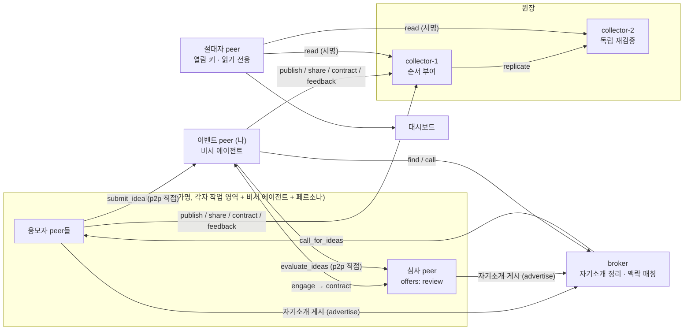
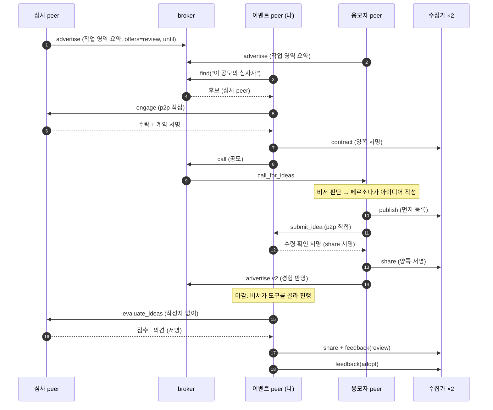

# 시스템 개요 (기술 설계)

이 문서가 신청서와 나머지 근거 문서의 기준입니다. 용어는 [review/premises.md](../review/premises.md)를 따릅니다. **검증** 표기: ✅ 실제로 실행해 확인, 📄 사양 문서로만 확인, ❓ 아직 확인하지 못함.

## 1. 한 장 요약

| 질문 | 답 |
|---|---|
| 무엇을 하는 시스템인가 | 임직원의 AI 에이전트(peer)들이 **가명**으로 서로 지식·아이디어를 주고받고, 그 거래와 공유를 **서명된 원장**에 증명으로 남기는 p2p + a2a 네트워크 |
| 시연 시나리오 | 심사 peer가 **역할을 기간을 정해 공개**해 둔다 → 이벤트 진행자(나)가 broker에서 심사자를 **발견해 역할 계약**(원장)을 맺는다 → **사내 아이디어 공모**를 올린다 → broker가 맥락으로 응모자 peer를 골라 알린다 → peer의 비서가 사원(페르소나)에게 전달 → 사원이 낸 아이디어를 p2p로 나에게 보낸다 → 마감 뒤 계약한 심사자가 심사하고 채택한다 |
| 흐름은 누가 정하나 | **에이전트가 정한다.** 코드는 서명 검증, 원장 규칙, 정책 같은 **안전장치만** 고정하고, 누구에게 무엇을 요청할지는 에이전트가 대화로 결정한다 |
| peer의 역할은 고정인가 | **아니다.** 모든 peer는 같은 종류의 노드이고, 아이디어 제공·소비·심사는 상호작용마다 달라지는 행동이다. 시연의 11명은 하나의 예시다 |
| 어떻게 만드나 | Python 3.11, A2A 1.0(`a2a-sdk`), Claude API(`anthropic`), SQLite·메모리, 전자 서명과 이어 붙인 기록(해시 체인) |

## 2. 설계 원칙

1. **역할은 노드의 종류가 아니라 행동이다.** 시스템에는 "심사자 노드"가 없다. 어떤 peer가 심사를 받을 수 있는지는 그 peer가 broker에 노출한 프로필(관심 분야, 할 수 있는 일)과 그 peer의 판단으로 정해진다. 시연에서 심사 peer는 broker에게 "공모 아이디어 심사에 능한 사람"을 맥락으로 물어 찾아낸 결과다.
2. **자기소개는 작업 영역에서 나온다.** 각 peer는 작업 영역(지식·경험 노트)을 가지고, 비서 에이전트가 이를 요약해 정체와 역할로 broker에 게시한다. 경험(응모, 심사)이 노트에 쌓이면 요약을 자동으로 다시 게시한다(버전 증가). 사람이 편집할 수도 있으나 시연은 자율성을 위해 자동이다. 설정 파일의 고정 문장이 아니라 노트가 원천이다.
3. **고정하는 것과 에이전트에게 맡기는 것을 나눈다.**

   | 코드가 고정(안전장치) | 에이전트가 결정(유연한 흐름) |
   |---|---|
   | 서명 검증, 이중 서명 요구, 해시 체인, 먼저 등록한 기록 우선 규칙, 재전송 거절 | 공모를 누구에게 알릴지(broker의 맥락 판단) |
   | 가명↔소유자 대응표의 접근 통제와 접근 기록 | 비서가 사원에게 전달할지 말지(관심·성향 판단) |
   | peer가 받을 수 있는 요청의 형식 | 사원이 어떤 아이디어를 낼지 |
   | | 마감 뒤 무엇을 할지: 아이디어 확인 → 심사 peer 탐색 → 심사 요청 → 채택(요청자 비서가 도구를 골라 쓴다) |
4. **발견은 broker가, 거래는 peer끼리, 증명은 수집가가 한다.** broker는 아이디어를 보지 않는다. 아이디어는 제출자 peer에서 요청자 peer로 직접 간다.
5. **사람을 대신하는 LLM과 에이전트의 LLM을 분리한다.** 시연에서 사원은 페르소나 프롬프트를 가진 LLM이고(진짜 사람 역할), 그 앞의 비서 에이전트는 별도의 LLM 호출이다. 실제 도입에서는 페르소나 자리에 사람이 들어온다.
6. **LLM이 없어도 흐름이 돈다.** 오프라인 템플릿 모드가 같은 흐름을 실행한다.

## 3. 기술 스택

| 영역 | 선택 | 검증 |
|---|---|---|
| 에이전트 통신 | A2A 1.0, JSON-RPC, `a2a-sdk[http-server]` 1.3.0. 모든 노드가 Agent Card(`/.well-known/agent-card.json`)를 공개하고 서로 직접 호출 | ✅ |
| LLM | 두 백엔드를 환경변수로 선택: **OpenAI 호환 엔드포인트**(`SUT_LLM_BASE_URL`, `SUT_LLM_API_KEY`; 현재 삼성SDS클라우드 Simple AI Inference, 기본 모델 `openai/gpt-oss-120b`) 또는 **Claude API**(`ANTHROPIC_API_KEY`, 기본 `claude-opus-5-5`). 에이전트용 `SUT_AGENT_MODEL`, 사원 페르소나용 `SUT_PERSONA_MODEL`. JSON 스키마 출력, 요청자 비서는 "다음 행동을 JSON으로 고르는" 루프(어느 백엔드에서나 동작) | ✅ 호환 엔드포인트(`gpt-oss-120b`)로 실행 확인. Claude 경로는 ❓ 키가 없어 미검증 |
| 서명·해시 | `cryptography` ed25519, SHA-256 | ✅ |
| 원장 | 해시 체인 append-only. collector-1이 순서를 매기고, collector-2가 같은 항목을 독립 검증해 따로 저장 | ✅ (메모리. 영속화 ❓) |
| 대시보드 | Starlette 단일 페이지(1.5초 폴링) | ✅ API 스모크 테스트, 화면 육안 확인은 ❓ |
| Python | 3.11 (이 PC 기본 3.9는 SDK 요구 미달이라 가상환경 사용) | ✅ |

Claude API 사용 시 모델 선택·구조화 출력·거절 처리는 `app/llm.py`에 모았고, 호출이 실패하거나 거절되면 오프라인 폴백으로 대체해 시연이 멈추지 않습니다.

## 4. 구성 요소 (실행 시 포트)



| 프로세스 | 포트 | 하는 일 |
|---|---|---|
| peer 11개 | 9101~9111 | 각자 가명(키 쌍)과 Agent Card를 가진다. 비서 에이전트가 요청을 받아 판단하고, 필요하면 사원(페르소나)에게 전달한다 |
| broker | 9210 | 노출 접수(서명 검증), 맥락 매칭. `call`(공모 알리기)과 `find`(peer 찾기) |
| 요청자(나) | 9300 | 공모 게시, 아이디어 수신과 수령 확인 서명, 비서 에이전트 루프 |
| collector-1 / 2 | 9201 / 9202 | 발행·공유·피드백 기록. 1이 순서를 정하고 2가 재검증 |
| **절대자 peer**(overseer) | (프로세스 내) | 원장을 **읽을 수 있는 키**를 가진 읽기 전용 peer. 두 수집가에서 원장을 가져와 스스로 검증하고 통계를 낸다. 대시보드는 이 peer의 창이다 |
| 대시보드 | 8000 | 공모 입력, 진행 로그, 도착한 아이디어, **피어의 자기소개(버전 갱신)**, 절대자의 통계·원장·무결성, 감사·변조 시연·실명 확인·열람 시도 |

## 5. 시연의 구성원 (예시)

11명이 같은 코드로 돌며 `app/personas.py`의 프로필만 다릅니다: 신입 마케터, 인프라 엔지니어, HR 담당, 영업 베테랑, 데이터 분석가, 신입 개발자, 총무, 보안 담당, 기획팀장, UX 디자이너, 그리고 `can: ["review"]`를 가진 심사 전문가 1명. `SUT_PERSONAS=파일.json`으로 구성원을 통째로 바꿀 수 있고, 시나리오가 달라져도 코드는 바뀌지 않습니다.

## 6. 흐름



| 단계 | 누가 | 무엇을 | 경유 |
|---|---|---|---|
| 0. 자기소개 게시 | 각 peer의 비서 → broker | 작업 영역 노트를 **스스로 요약**한 자기소개와 제공할 수 있는 역할, 공개 기간을 서명해 등록. 경험이 쌓이면 **자동 재게시(v2…)**. 기간이 지나면 검색되지 않음 | broker |
| 1a. 심사자 발견 | 나 → broker | "이 공모에 필요한 심사자"를 맥락으로 질의, 후보 반환 | broker |
| 1b. 역할 계약 | 나 ↔ 심사 peer | p2p로 연락. 심사 peer의 비서가 전문성에 맞으면 수락. 양쪽이 서명한 `contract`를 원장에 기록 | **직접** + 수집가 |
| 1c. 공모 | 나 → broker | 공모 내용을 올림 | broker |
| 2. 매칭 | broker | 맥락으로 의견을 줄 만한 peer를 골라 `call_for_ideas`를 전달, 답변지(누구에게 알렸는지)를 나에게 반환 | broker → peer |
| 3. 비서 판단 | peer의 비서 | 사원의 관심·성향에 맞는지 판단해 전달 여부 결정(안 할 수도 있다) | peer 내부 |
| 4. 아이디어 | 사원(페르소나) | 자신의 직무 경험에서 아이디어를 만든다 | peer 내부 |
| 5. 제출 | peer → 나 | 아이디어와 서명을 **p2p로 직접** 보낸다. 이때 처음 연결이 생긴다 | **직접** |
| 6. 수령 확인 서명 | 나 → peer | 해시·작성자 서명을 검증하고, 수령 확인 서명에 서명해 돌려준다 | **직접** |
| 7. 증명 | peer → collector | 발행(작성자 서명)과 공유(양쪽 서명)를 원장에 기록 | 수집가 |
| 8. 마감 | 나의 비서 | 목표(최대 3개 채택)와 도구(`list_ideas`, `discover_peer`, `request_review`, `adopt`)를 받고 다음 행동을 고르도록 설계. **실제 LLM에서는 빈 응답으로 실패해 고정 순서(계약한 심사자에게 심사 요청 → 채택)로 대체됨** | 에이전트 루프(불안정) |
| 9. 심사 | 계약된 심사 peer | 아이디어(작성자 정보 없이)를 받아 점수와 의견을 낸다. 공유와 심사가 원장에 기록된다. **계약이 없으면 심사 기록은 거절된다** | **직접** + 수집가 |
| 10. 채택 | 나의 비서 | 심사 의견을 근거로 채택해 원장에 피드백으로 기록 | 수집가 |

원장 규칙은 한 번 더 코드가 지킵니다. 예컨대 심사 peer는 아이디어를 **받은 뒤에만** 피드백을 남길 수 있고, 같은 아이디어를 나중에 다른 가명이 발행하면 거절됩니다.

## 7. 원장

원장에는 **내용이 아니라 해시, 가명, 서명, 시각**(그리고 심사 점수)만 담습니다. 심사 의견과 채택 이유는 해시로만 기록하고 본문은 지식 저장소에 둡니다. 내용은 지식 저장소(MVP는 메모리 사전)에 두어 삭제할 수 있습니다.

| 항목 | 필수 서명 | 용도 |
|---|---|---|
| `contract` | 이벤트 peer + 계약자 | 역할 역할 계약(예: 이 공모의 심사자). 계약이 있어야 해당 공모의 심사 기록이 허용됨. nonce로 재전송 거절 |
| `publish` | 작성자 | 먼저 등록했다는 증명(같은 내용 해시를 먼저 올린 가명이 먼저 등록한 사람). **응모자는 아이디어를 보내기 전에 먼저 기록**하므로 받는 쪽이 먼저 등록할 수 없다 |
| `share` | 제공자 + 소비자 | 아이디어 제출, 심사 요청 등 "내용이 넘어갔음"을 양쪽이 서명. nonce로 재전송 거절 |
| `feedback` | 평가자 | 심사 의견·채택. 내용을 받은 사람만 기록 가능 |

기여 집계: 가명별로 자기 내용을 받은 서로 다른 사람의 수와 채택 수.

**보장하는 것과 보장하지 않는 것**

| 보장한다 | 보장하지 않는다 |
|---|---|
| 누가 언제 어떤 순서로 서명했는가 | 아이디어의 진위·품질 |
| 양쪽이 공유에 동의했는가 | 작성자가 실제 창작자인가(남의 것을 먼저 올리면 그 가명이 먼저 등록한 사람) |
| 서명이 있는 과거 항목을 몰래 고치면 감사와 다른 수집가와의 대조로 드러나는가 | 두 수집가의 공모, 항목 삭제·절단(미검증), 다수 가명을 이용한 기여 부풀리기 |
| 내용을 지워도 증명 구조가 유지되는가 | |

## 8. 절대자 peer (원장 열람 권한자)

원장을 마음대로 볼 수 있는 peer를 하나 둡니다. 다른 peer와 같은 종류의 노드이고, 수집가의 **열람 허용 목록(allow-list)**에 이 peer의 공개키가 들어 있다는 점만 다릅니다.

| 할 수 있는 것 | 할 수 없는 것 |
|---|---|
| 두 수집가의 원장 전체를 읽는다(서명된 열람 요청, 60초 이내 시각) | 원장에 기록한다(쓰기 경로는 별개이며 서명 규칙을 따른다) |
| 가져온 사본의 해시와 서명을 **스스로 검증**하고 두 수집가를 대조한다 | 내용을 본다(원장에는 해시·가명·서명·점수뿐. 아이디어 원문, 심사 의견, 채택 이유는 해시로만 남고 본문은 지식 저장소에 있다) |
| 통계를 낸다: 항목 수와 종류, 가명 수, 아이디어·채택·채택률, 심사 건수·평균·점수 분포, 기여 상위, 공유 흐름 상위 | 가명의 실제 소유자를 안다(실명 확인은 감사 담당이 사유를 남겨야만 가능한 별도 경로) |

- 허용 목록에 없는 키의 열람은 거부되고 접근이 기록됩니다(대시보드의 "권한 없는 peer의 열람 시도" 버튼으로 시연).
- 대시보드에는 원장에 이르는 다른 길이 없습니다. 화면의 원장 표와 통계는 모두 이 peer가 가져온 것입니다. 한 수집가의 과거 항목을 고치면 이 peer가 무결성 경고를 냅니다.
- **한계**: 열람 권한 자체가 강력합니다. 어느 가명이 누구와 얼마나 주고받았는지 한눈에 보이므로 **누구에게 이 키를 줄지**가 곧 정책입니다. MVP는 키 하나를 시작 때 허용 목록에 넣는 방식이며 권한 회수·다수 열람자·열람 사유 기록은 구현하지 않았습니다(접근 기록만 남깁니다).

## 9. 가명과 실명 확인

peer의 식별자는 공개키(화면에는 `가명-xxxxxx`)입니다. 소유자 대응표는 감사 담당만 보고, **사유가 없으면 거부하며 접근을 기록**합니다(대시보드의 실명 확인 버튼으로 시연). 상대 peer와 심사 peer에게는 가명만 보입니다. 완전한 익명이 아니라 가명이며, 희소한 내용은 내용만으로 추정될 수 있습니다.

## 10. 실행 방법

```
python3.11 -m venv .venv && .venv/bin/pip install -r requirements.txt
export ANTHROPIC_API_KEY=...                                  # 없으면 오프라인 템플릿 모드
.venv/bin/python -m app.run_demo                              # 대시보드 http://127.0.0.1:8000
.venv/bin/python -m app.run_demo --call "공모 내용" --quiet 20  # 대시보드 없이 한 번 실행하고 결과 출력
SUT_OFFLINE=1 ...                                             # 키가 있어도 오프라인 강제
```

## 11. 검증 현황

| 항목 | 상태 | 근거 |
|---|---|---|
| 11개 peer + broker + 요청자 + 수집가 2개가 각자 A2A 서버로 뜨고 서로 직접 호출 | ✅ | `app.run_demo` 실행 |
| 공모 → 매칭 → 비서 판단 → 제출 → 수령 확인 서명 → 원장 → 심사 peer 탐색·심사 → 채택 | ✅ (오프라인 모드) | 같은 실행. 6명이 제출, 원장 27건, 채택 3건 |
| 두 수집가의 기록 일치, 변조 시 collector-1만 `TAMPERED` | ✅ | 같은 실행의 감사 출력 |
| 먼저 등록(중복 발행 거절), 재전송 거절, 서명 재검증 감사 | ✅ | `proto/spike_ledger.py` |
| 웹 API(게시, 마감, 감사, 실명 확인 거부) | ✅ | curl 스모크 테스트 |
| 절대자 peer: 허용된 키만 열람, 권한 없는 열람 거부·기록, 통계, 변조 시 무결성 경고 | ✅ | 실행과 API 테스트 |
| **실제 LLM(`gpt-oss-120b`)으로 전 흐름**: 자기소개 게시, 심사자 발견·계약, broker 매칭(6명 선택), 비서 판단(3명 거름), 페르소나 아이디어 3건, 계약된 심사자의 점수, 채택 3건, 원장 19건 일치, 절대자 통계 | ✅ | 1회 실행 약 1분. 기록: `review/evidence/live-run-gpt-oss-120b.txt` |
| **peer 비서의 작업 영역 요약과 자동 갱신(v1→v2)** | ✅ | 실제 LLM 실행, 제출·심사 후 4~5명이 스스로 갱신 |
| **요청자 비서의 자율 행동 루프** | ⚠ 1회 성공 | 앞선 두 실행은 응답 형식 오류(`empty content`, JSON 뒤 여분 출력)로 고정 순서로 대체. 파서 수정 뒤 1회는 `list_ideas → request_review ×2(중복) → adopt ×3 → 종료`를 스스로 선택. 반복 안정성 미확인 |
| Claude 경로(키 없음), 대시보드 화면 육안 확인, 여러 번 반복 실행의 안정성 | ❓ | |
| 서로 다른 PC·서버 간 호출, 원장 영속화, 항목 삭제·절단 탐지 | ❓ | |
