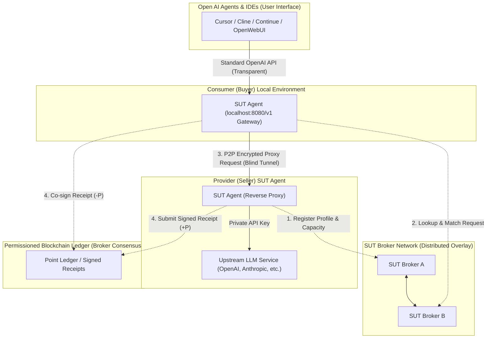
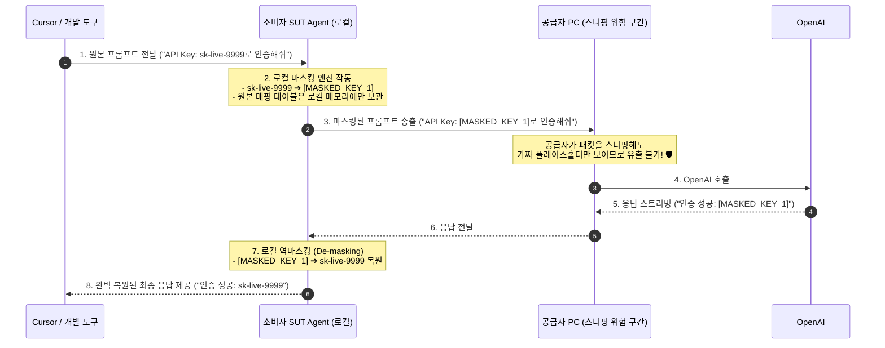
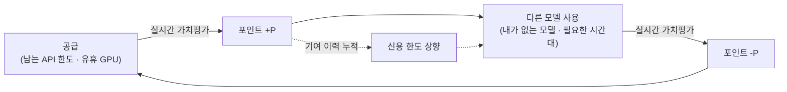

# Share-Ur-Tokens (SUT) 시스템 개요 및 아키텍처

> **탈중앙화 P2P LLM 토큰 공유 네트워크**  
> 조직이 계약한 상용 LLM과 구성원·참여자의 GPU 오픈 모델을 하나의 입구로 골라 쓰고, 제공한 서비스는 실시간 가치평가를 거쳐 포인트로 돌려받아 다른 모델을 쓰는 데 사용하는 선순환형 P2P 공유 플랫폼입니다.

---

## 1. 프로젝트 비전 및 배경

### 1.1 배경 및 문제 정의
- **소멸하는 유휴 자원**: 선불 API 크레딧은 기한이 지나면 사라지고(예: OpenAI 선불 크레딧은 구매 후 1년 뒤 소멸), 개인 GPU의 유휴 시간은 저장해 둘 수 없습니다. 후불 API 키의 쓰지 않은 예산은 버려지는 자원이 아니므로 "낭비" 문제에 해당하지 않습니다.
- **흩어진 AI 자원과 접근 장벽**: 조직 안에서는 부서마다 다른 AI 서비스를 따로 계약해 라이선스가 중복되고, 구성원은 필요한 모델마다 계정 발급·키 설정을 따로 거쳐야 합니다. 개인은 오픈 모델을 쓰려 해도 GPU가 없거나, 상용 서비스의 무료 등급은 사용량 제한이 있습니다.
- **중앙화 플랫폼의 한계**: 기존의 중앙화 중계 서비스는 마진 수수료, 개인정보(프롬프트) 검열, 중앙 서버 단일 장애점(SPOF), 그리고 API Key 유출 위험이 존재합니다.

### 1.2 핵심 가치 (Value Proposition)
- **공급자 (Provider)**: API 한도의 여유분이나 유휴 GPU의 추론 자원을 공유하고, 제공한 서비스만큼 포인트를 받음. (공급 대상은 1.3절 참조)
- **소비자 (Consumer)**: 개인 구독이나 계정 개설 없이, 로컬 엔드포인트 하나로 접근 권한이 있는 공급원(조직 계약 상용 모델, 공개 오픈 모델)을 골라 필요한 만큼 쓰고 포인트로 정산. 신규 참여자도 작은 신용 한도로 바로 시작 가능.
- **사용자별 접근 범위**: 핵심 사용자는 **조직 구성원**이며, 조직이 계약한 상용 모델과 동료의 GPU 모델을 함께 씁니다. 조직에 속하지 않은 개인·학생은 **공개 풀의 오픈 모델**을 돈 대신 기여(GPU 공유)로 씁니다. 상용 고성능 모델은 조직 계약 범위 안에서만 쓸 수 있습니다.
- **가명성 (Pseudonymity)**: 참여자는 실명 대신 가명(DID)으로 활동하며, 소비자의 DID는 업스트림 API 업체에 전달되지 않음. 단, 포인트 원장 안에서는 신용 한도와 제재를 위해 같은 DID가 같은 사람으로 식별되고, 조직 공유에서는 조직 계정(실명)과 연결됨. 공급자 피어는 전달받은 대화 내용을 볼 수 있으며, 피어를 자주 바꿀수록 대화 전체를 보는 상대가 늘어남 (4.2절, [P2P 네트워크 및 DID 구조](p2p-and-identity.md) 3.3절 참조).
- **P2P & 무신뢰(Trustless)**: 중앙 서버 없이 Broker 네트워크와 Broker 합의형 블록체인 원장을 통해 자동화된 매칭 및 포인트 정산 수행.
- **무상태(Stateless) 내결함성 + Sticky 라우팅**: 장시간 연결 유지가 필요한 기존 P2P와 달리, 턴 단위 무상태 마이크로 태스크와 클라이언트 측 대화 기억(Context) 관리로 피어 이탈(Churn) 시 다른 피어로 대화를 이어감. 평소에는 같은 세션을 같은 피어로 보내 캐시 효율을 유지하고, 장애 시에만 교체 (Failover).
- **가명 통신 및 보안**: Peer 간에는 서로의 실명이나 원본 API Key를 알지 못한 채, 공급자마다 다른 파생 DID와 암호화 터널로 통신.

### 1.3 공급 전제: 공급원의 이용 조건 준수 (Supply Premise)

> **SUT의 모든 공급은 그 공급원의 이용 조건을 반드시 따른다는 것을 전제로 합니다.**
> 공급원의 이용 조건이란 업체 약관(상용 API), 모델 라이선스(오픈 가중치 모델), 조직 정책(사내 계약 자원)을 말합니다. 이용 조건이 허용하는 서비스만 공유할 수 있으며, 허용하지 않는 서비스는 SUT에서 공급할 수 없습니다.

- **공급자의 책임**: 공급자는 자신이 등록하는 자원의 이용 조건을 확인하고 지킬 책임이 있습니다. 상용 API 약관은 대체로 키 보유자의 계정에서 일어난 모든 활동의 책임을 키 보유자에게 둡니다.
- **SUT의 역할**: SUT는 특정 서비스를 정해 두지 않는 중립적인 공유 구조입니다. 공급자가 자원을 등록할 때 그 자원의 이용 조건을 **공급 정책 프로파일**로 함께 등록하고, Broker는 프로파일이 허용하는 소비자와 용도에만 매칭합니다.
- **조건 변경 반영**: 공급원의 이용 조건이 바뀌면 프로파일만 갱신합니다. 구조를 바꿀 필요가 없습니다.

| 공급원 예시 | 적용되는 이용 조건 | 프로파일에 따른 공유 범위 |
| :--- | :--- | :--- |
| **개인 GPU + 오픈 LLM** (vLLM, Ollama, llama.cpp) | 모델 라이선스 | 라이선스가 허용하는 범위에서 공개 공유 (사용자 수·용도 제한이 있으면 반영) |
| **개인 GPU + 생성 모델** (이미지 등) | 모델 라이선스 + 콘텐츠 안전 기준 | 라이선스 범위에서 공개 공유. 생성 전후 안전 필터 통과 필수 |
| **조직 계약 상용 API** (OpenAI, Anthropic 등) | 업체 약관 + 조직 정책 | 같은 조직 구성원에게만 공유 |
| **개인 상용 API 키** | 업체 약관 | 약관이 제3자 제공을 허용하지 않으면 공유 불가. 업체 승인 등으로 허용되면 프로파일 변경으로 확장 |
| **소비자용 구독** (ChatGPT Plus/Pro, Claude Pro/Max 등) | 업체 약관 | 공유 불가. API 키를 제공하지 않는 개인 사용 권한임 |

---

## 2. 시스템 핵심 구성 요소 (Core Components)



### 2.1 SUT Agent
개인 사용자가 로컬 머신 또는 개인 서버에 설치하는 경량 백그라운드 데몬/클라이언트입니다. 특정 전용 UI에 종속된 폐쇄형 구조가 아니며, **로컬 HTTP 게이트웨이, 표준 입출력(stdin/stdout) IPC, 플러그인 확장** 등 다양한 방식으로 로컬의 모든 오픈형 AI 에이전트와 유연하게 결합됩니다.

- **다양한 로컬 프로세스 연동 인터페이스 (Multi-Interface Connectivity)**:
  1. **HTTP/REST 게이트웨이 모드**:
     - 로컬에 `http://localhost:8080/v1` (OpenAI/Anthropic 표준 호환) 엔드포인트 제공.
     - **Cursor, Continue.dev, Cline, OpenWebUI** 등의 설정에서 Base URL만 변경하여 즉시 사용.
  2. **표준 입출력 (stdin / stdout) IPC & MCP 모드**:
     - 포트 충돌이나 네트워크 소켓 오버헤드 없이, 프로세스 간 파이프(Pipe)를 통해 고속 스트리밍 데이터 교환.
     - **MCP (Model Context Protocol)** 지원: `stdio` 기반 JSON-RPC 통신을 통해 Claude Desktop, Cursor 등의 네이티브 Tool/Resource로 직접 플러그인 등록 가능.
     - 터미널 CLI 파이프라인 지원 (`cat prompt.txt | sut-agent run --model claude-sonnet-5-5 > output.txt`).
  3. **네이티브 플러그인 / 익스텐션 모드 (Plugin Mode)**:
     - VS Code, Cursor 등의 Extension/Plugin 형태로 패키징되어, 별도 설치 없이 IDE 백그라운드 서브프로세스로 자동 실행 및 생명주기 관리.

- **제공자 모드 (Provider Mode)**:
  - 사용자가 업스트림 LLM 엔드포인트(예: OpenAI, Anthropic, Ollama 등)와 API Key를 로컬 환경설정에 등록.
  - SUT Agent가 해당 엔드포인트의 유효성, 지원 모델(Context window, RPM/TPM 등)을 검증하여 **검증된 프로필(Verifiable Profile)** 자동 생성.
  - 제공자는 공유할 최대 토큰 한도(Limit), 공유 시간대, 허용 모델 등을 직접 지정.
  - 외부로 API Key를 절대 유출하지 않고, 인입된 요청을 로컬에서 대신 호출해 주는 **Reverse Proxy** 역할 수행.

- **소비자 모드 (Consumer Mode)**:
  - 로컬 포트(`localhost:8080`)로 들어오는 프롬프트 요청을 가로채, Broker 네트워크를 통해 조건(모델, 지연시간, 포인트 효율)에 맞는 최적의 공급자 Peer를 즉시 매칭하고 E2EE P2P 터널로 연결.
  - **로컬 자동 마스킹 엔진 (Data Sanitizer)**: 프롬프트에 포함된 API Key나 개인정보(이메일, 전화번호 등)를 감지하여 네트워크 송출 전 가짜 플레이스홀더(`[MASKED_KEY]`)로 자동 치환하고, LLM 응답 수신 시 원래 값으로 자동 복원(De-masking).

- **보안 및 측정 모듈**:
  - 입출력 토큰(Token Count)을 실시간 파싱 및 정량화.
  - 암호학적 서명(Signed Attestation)을 생성하여 사용량 증명 발행.

### 2.2 SUT Broker Network
P2P 디스커버리(Discovery) 및 매칭을 담당하는 분산형 브로커 노드 네트워크입니다.
- **분산 오버레이 (Distributed DHT / Gossip)**:
  - 중앙 서버 없이 분산된 복수의 SUT Broker가 상호 연결되어 노드 및 가용 리소스 풀을 동기화.
  - Agent는 지연시간(RTT)이 가장 가까운 인접 브로커에 자동 연결 및 헬스체크 등록.
- **프로필 레지스트리 (Service Registry)**:
  - 각 Agent가 제공할 수 있는 LLM 스펙, 가용 토큰량, 신뢰도 점수(Reputation)를 인덱싱.
  - Agent 스스로 프로필 스펙을 허위 조작할 수 없도록 초기 핑/검증 챌린지 프로토콜 적용.
- **스마트 매칭 엔진**:
  - 소비자의 요구 조건(모델 종류, 필요 토큰량, 포인트 효율)에 부합하는 최적의 단일 또는 복수(Multi-peer fallback) 공급자 Agent를 탐색하여 P2P 핸드셰이크 주선.
  - **공급 정책 프로파일 검사**: 매칭 전에 소비자가 해당 공급원의 공유 범위(예: 같은 조직 구성원 여부, 라이선스상 허용 용도)에 들어가는지 확인하고, 범위 밖이면 매칭하지 않음. (1.3절 참조)

### 2.3 포인트 원장 (Permissioned Blockchain Ledger)
Broker 노드들이 합의해 운영하는 허가형 블록체인 원장입니다. 제공·사용한 토큰과 그 가치평가 결과(포인트)를 영구히 기록합니다. (상세: [포인트 원장 및 정산](ledger-and-settlement.md))
- **사용량 기록 및 영수증 (Proof of Usage)**:
  - 완료된 요청의 입력·출력·캐시 토큰 수량과 평가 포인트를 양측이 서명(Dual Signature)해 원장에 기록.
  - 블록 해시 체인과 Broker 합의로 기록 위변조를 차단.
- **상호신용 정산**:
  - 공급자 +P, 소비자 -P로 기록되어 전체 합계는 항상 0.
  - 신규 참여자는 작은 신용 한도(마이너스 허용)로 시작하며, 기여 이력에 따라 한도가 늘어남.
- **분쟁 처리**: 정책 위반 등 분쟁은 서명 증거를 바탕으로 복수 Broker가 심사. (상세: [분쟁 해결 및 공급자 보호](dispute-and-indemnity.md))

---

## 3. 핵심 워크플로우 (Workflows)

### 3.1 공급자 (Token Provider) 등록
1. 사용자가 SUT Agent를 실행하고 공급원(로컬 오픈 모델 엔드포인트 또는 조직 계약 API 키)과 일일 공유 한도(예: 500,000 토큰)를 설정.
2. 해당 공급원의 이용 조건에 맞는 **공급 정책 프로파일**(공유 범위, 허용 용도)을 선택. (1.3절 참조)
3. SUT Agent가 자체 테스트 호출을 통해 모델 티어 및 응답성을 확인.
4. 변조 불가능한 프로필 해시(Profile Digest)를 생성하여 공급 정책 프로파일과 함께 인접 SUT Broker에 등록.
5. Broker 네트워크 전역으로 프로필 메타데이터가 전파되어 대기 상태(Standby)로 전환.

### 3.2 소비자 (Token Consumer) 매칭 및 연결
1. 소비자는 SUT Agent에 원하는 조건(예: `claude-sonnet-5-5`, 최대 10,000 토큰, 포인트 효율 우선)을 입력.
2. 소비자 Agent가 Broker 네트워크를 통해 조건에 부합하는 공급자 Agent 후보군을 질의.
3. Broker는 매칭된 공급자 노드의 P2P 연결 정보(ICE/STUN/TURN 기반 주소)를 전달.
4. 양자 간에 직접 엔드투엔드 암호화 터널(E2EE P2P Tunnel)이 수립됨.

### 3.3 백그라운드 트랜잭션 및 LLM 요청 처리
1. 소비자의 프롬프트 요청이 암호화 터널을 통해 공급자의 SUT Agent로 전달.
2. 공급자 Agent는 프롬프트를 자신의 업스트림 LLM(OpenAI 등)으로 포워딩.
3. 응답 스트림이 소비자의 Agent로 실시간 릴레이.
4. 요청 완료 후, 양측 Agent는 송수신된 실제 토큰 수를 계산하고 사용량 티켓에 서명.
5. 최종 영수증이 블록체인 원장에 기록되고, 제공된 서비스를 가치평가한 포인트가 공급자 +P, 소비자 -P로 반영됨.

---

## 4. 프라이버시 및 실용주의적 보안 철학 (Pragmatic Security Philosophy)

> **투명한 트레이드오프(Trade-off) 고지**:  
> SUT는 구독 없이 서로의 LLM 자원을 필요한 만큼 나눠 쓰는 **실용성 중심 플랫폼**입니다. 전송 구간은 암호화되지만, **최종 프록시를 수행하는 공급자 PC 환경에 프롬프트가 노출될 수 있는 기술적 한계를 투명하게 인정**하고 이에 맞는 적합한 유즈케이스를 정의합니다.

### 4.1 핵심 보안 및 보호 영역

| 항목 | 보안 목표 | SUT 기술 메커니즘 |
| :--- | :--- | :--- |
| **API Key 보호** | 타인에게 API Key 노출 원천 차단 | 공급자 Agent 로컬 내부에만 암호화 보관되며, 프록시 요청만 처리 (외부 유출 불가) |
| **P2P 전송 보안** | 제3자 및 ISP 도청 방지 | libp2p QUIC + Noise Protocol 기반 엔드투엔드(E2EE) 암호화 터널 적용 |
| **토큰 카운트 부정** | 소비 토큰 과대/과소 청구 방지 | 업스트림 `usage` 값 기준 + 소비자 측 근사 검증, 양측 서명 영수증 |
| **프로필 조작 방지** | 가짜 성능/모델 등록 시도 차단 | Broker의 핑/벤치마크 챌린지 및 신뢰도 점수 |

### 4.2 컨텍스트 노출에 대한 실용적 한계와 사용 가이드라인

공급자는 자신의 PC에서 최고 권한(Root/Admin)을 가지므로, 소프트웨어적으로 프롬프트의 완전한 은닉은 불가능합니다. 그러나 **대부분의 일상적 AI 활용은 컨텍스트가 외부에 노출되어도 무방한 비민감 데이터**이므로 SUT의 실용적 가치는 매우 큽니다.

- **권장 유즈케이스 (SUT 사용 최적)**:
  - 개인 개발 공부, 오픈소스 알고리즘 질문, 에러 로그 디버깅
  - 대량 외신/논문 번역, 웹 크롤링 데이터 요약
  - 일회성 아이디어 브레인스토밍, 비실시간 대량 배치 작업
- **비권장 유즈케이스 (공식 직접 구독 권장)**:
  - 기업 비밀 소스코드, 미공개 특허/재무 데이터, 고객 개인정보(PII)
  - *이러한 극비 데이터는 SUT가 아닌 OpenAI/Anthropic의 공식 계정으로 직접 사용하는 것을 권장합니다.*

### 4.3 로컬 자동 비밀키/개인정보(PII) 마스킹 파이프라인

프롬프트가 네트워크로 송출되기 전, **소비자 Agent가 로컬에서 민감 정보를 가짜 토큰으로 자동 치환(Pre-masking)**하고, 응답을 받아왔을 때 **원래 값으로 자동 복원(Post-de-masking)**합니다.



- **자동 감지 및 마스킹 대상**:
  - API Keys 및 시크릿 토큰 (`sk-...`, AWS Key, GitHub Token, Private Key 등 정규식 탐지)
  - 개인 식별 정보 (이메일, 주민번호/전화번호, IP 주소, 신용카드 번호 등)
- **효과**: 공급자 PC가 트래픽을 가로채거나 로깅하더라도 **실제 비밀키와 개인정보는 애초에 네트워크에 실리지 않으므로 안전**합니다.

---

## 5. 포인트 순환 구조 (Point Circulation)

SUT에서 참여자가 주고받는 것은 토큰 자체가 아니라, **제공한 서비스를 실시간으로 가치평가한 포인트**입니다. 포인트는 공급·사용 정산용이며, 계정 간 이전 없이 공급과 사용으로만 움직입니다.



### 5.1 왜 토큰이 아니라 포인트인가
- 토큰 1개의 가치는 **모델마다, 토큰 종류(입력·출력·캐시)마다, 시간대마다** 다릅니다.
- 포인트는 이 차이를 실시간 가치평가로 맞춘 공통 지표입니다. 그래서 "심야에 경량 모델을 많이 공급한 사람"과 "업무 시간에 상위 모델을 조금 쓴 사람"을 같은 저울로 비교할 수 있습니다. (상세: [실시간 가치평가 메커니즘](valuation-mechanism.md))

### 5.2 선순환을 만드는 3가지 장치
1. **교차 사용 (품앗이)**: 내가 공급하는 모델로 받은 포인트로, 접근 권한이 있는 다른 공급원의 모델을 사용합니다. 예를 들어 같은 조직 안에서 OpenAI API를 공급한 구성원이 다른 구성원이 공급한 삼성SDS 클라우드 모델이나 GPU 오픈 모델을 씁니다.
2. **먼저 쓰고 나중에 기여**: 신규 참여자는 잔액 0에서 작은 신용 한도로 바로 사용할 수 있어, 첫 거래가 막히지 않습니다. 공급 이력이 쌓일수록 한도가 늘어납니다.
3. **시간대별 가치평가**: 수요가 몰리는 시간대에 공급하면 포인트를 더 받고, 공급이 남는 시간대에 쓰면 덜 차감됩니다. 참여자들이 서로의 빈 시간을 자연스럽게 메워 줍니다.

---

## 6. 기대 효과 및 유즈케이스

1. **조직 구성원 (핵심 사용자)**: 개인 결제나 계정 발급 없이 하나의 로컬 엔드포인트로 조직이 계약한 여러 상용 모델과 동료의 GPU 모델을 골라 쓰고, 사용량은 포인트로 공정하게 정산. 부서별 중복 계약을 줄임.
2. **GPU 보유 개인 / 학생 (공개 풀)**: 상용 서비스에 돈을 쓰는 대신 자기 GPU 시간을 공유해 받은 포인트로 다른 오픈 모델을 사용. 무료 등급과 달리 기여한 만큼 더 쓸 수 있음.
3. **분산형 AI 인프라**: 단일 게이트웨이에 종속되지 않고 참여자끼리 LLM 자원을 순환시키는 P2P 공유 생태계 구축.

---

## 7. 프로젝트 디렉토리 및 로드맵 제안

```text
share-ur-tokens/
├── docs/
│   ├── system-overview.md             # 본 문서 (시스템 개념 및 전체 아키텍처)
│   ├── hackathon-proposal.md          # 해커톤 참가 신청서 (1~7 문항 기획서)
│   ├── valuation-mechanism.md         # 실시간 가치평가 메커니즘 (토큰 → 포인트)
│   ├── p2p-and-identity.md            # P2P 통신, 가명(DID) 식별 범위 및 브로커 구조
│   ├── ledger-and-settlement.md       # 포인트 원장(허가형 블록체인) 및 정산 아키텍처
│   ├── feasibility-and-compliance.md  # 기술 실현 가능성 및 공급원 이용 조건 준수 구조
│   ├── market-analysis-and-competitors.md # 시장 유사 서비스 분석 및 경쟁력 비교
│   ├── privacy-and-tool-calling.md    # 로컬 마스킹 및 안전한 툴 콜링(Tool Calling)
│   ├── dynamic-peer-switching.md      # 턴 단위 동적 피어 스위칭 및 장애 복구(Failover)
│   ├── dispute-and-indemnity.md       # 정책 위반 분쟁 해결 및 공급자 보호
│   └── protocol-spec.md               # 통신 프로토콜 및 메시지 포맷 (추후 작성)
├── agent/                        # SUT Agent 소스코드 (Go / Rust / Node.js)
│   ├── proxy/                    # LLM API Reverse Proxy & Tokenizer
│   ├── p2p/                      # P2P 연결 (libp2p, WebRTC)
│   └── ledger/                   # 영수증 서명 및 원장 연동
└── broker/                       # SUT Broker 소스코드 (분산 노드 디스커버리)
    ├── discovery/                # DHT / Kademlia / Gossip 노드 검색
    ├── matching/                 # 조건 기반 공급자-소비자 매칭 엔진
    └── ledger/                   # 허가형 블록체인 원장 노드 (합의·복제)
```

