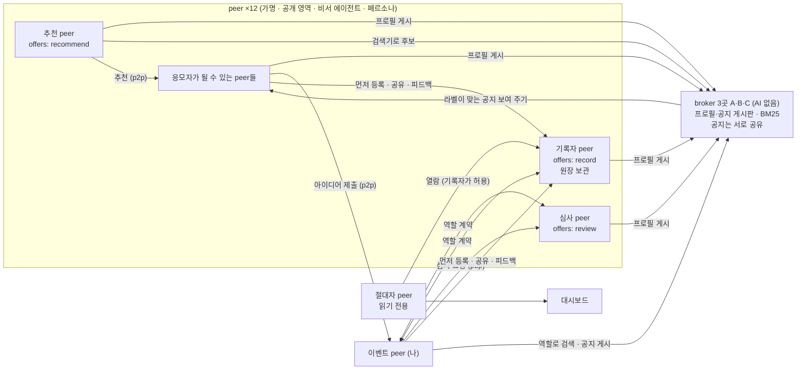
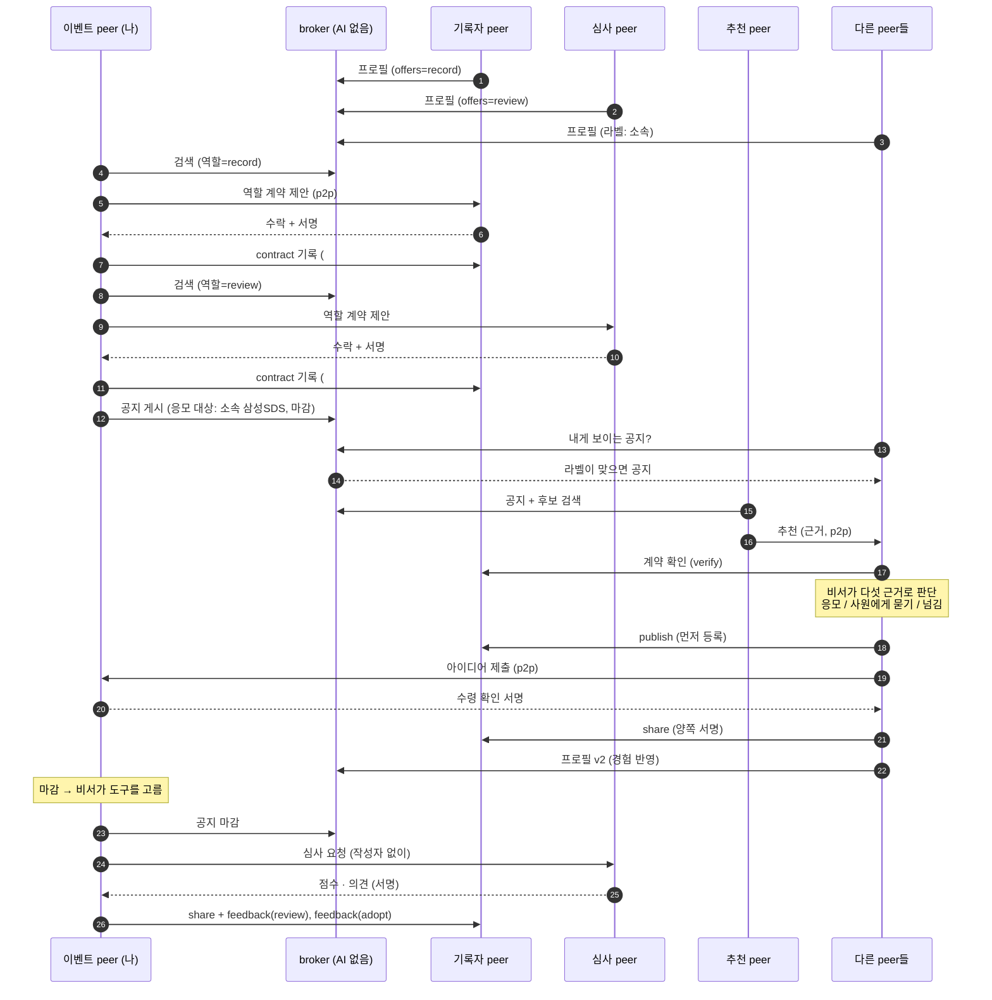

# 시스템 개요 (기술 설계)

이 문서가 신청서와 나머지 근거 문서의 기준입니다. 용어는 [review/premises.md](../review/premises.md)를 따릅니다. **검증** 표기: ✅ 실제로 실행해 확인, 📄 사양 문서로만 확인, ❓ 아직 확인하지 못함.

## 1. 한 장 요약

| 질문 | 답 |
|---|---|
| 핵심 메시지 | 필요하거나 원하는 정보에 다가가고 참여하는 일을, 내 에이전트가 **더 능동적으로, 더 제대로, 더 효율적으로** 해 준다. 부서·회사 같은 커뮤니티 단위로 쓸 때 가장 강하고, 게시판·기록을 구성원 peer가 맡으므로 중앙 서버와 운영 조직이 필요 없다 |
| 무엇을 하는 시스템인가 | **에이전트 아레나.** 커뮤니티 구성원마다 하나씩 있는 AI 에이전트(peer)가 자신을 소개하고, 게시판(broker)의 공지를 보고 스스로 판단해 서로 직접 연결하며(p2p) 대화로 일을 풀고(a2a), 그 거래·공유를 **서명된 분산 원장**에 증명으로 남기는 네트워크 |
| 시연 시나리오 | 사내 아이디어 공모. 이벤트 peer(나)가 broker 검색으로 기록자·심사자를 찾아 **역할 계약**(원장)을 맺고, **공지**(응모 대상: 삼성SDS 전사원)를 게시한다 → 라벨이 맞는 peer 전원에게 보이고 추천 peer가 맞는 사람을 추천한다 → 각 peer의 비서가 **다섯 가지 근거로** 응모·사원에게 묻기·넘김을 정한다 → 아이디어가 p2p로 온다 → 마감 뒤 나의 비서가 계약한 심사자에게 맡기고 채택한다 |
| 흐름은 누가 정하나 | **각 peer의 에이전트.** 코드는 게시판의 대상 필터, 서명 검증, 원장 규칙, 역할 충돌 규칙만 고정한다 |
| broker에 AI가 있나 | **없다.** 게시, 대상 필터, BM25 검색만 한다. AI가 필요한 매칭은 추천 역할의 peer가 한다. 시연은 broker 3곳이 공지를 서로 공유한다 |
| peer의 역할은 고정인가 | **아니다.** 구성원은 peer 한 종류이고, 기록·추천·심사·응모는 peer가 공개하거나 계약으로 맡는 역할이다. 시연의 12명은 하나의 예시다 |
| 어떻게 만드나 | Python 3.11, A2A 1.0(`a2a-sdk`), LLM 어댑터(Claude API 또는 OpenAI 호환), BM25 검색기, 전자 서명과 이어 붙인 기록(해시 체인) |

## 2. 설계 원칙

1. **구성원은 peer 한 종류, 역할은 행동이다.** 시스템에 "심사자 노드"나 "기록 서버"가 따로 없다. 역할은 두 묶음이다.

   | 묶음 | 역할 | 맡는 방식 |
   |---|---|---|
   | 인프라 역할(상시 공개) | broker(게시판·검색, AI 없음), recorder(원장 기록), 추천(자기 AI로 매칭) | 프로필에 `offers`로 공개 |
   | 이벤트 역할(건별) | 요청자, 응모자, 심사자 | 공지와 역할 계약(양쪽 서명, 원장) |

2. **프로필은 공개 영역에서 나온다.** 각 peer는 공개 영역(지식·경험 노트, 소유자 규칙, 현재 상황)을 가지고, 비서가 이를 요약해 프로필로 게시한다. 응모·심사·추천 같은 경험이 노트에 쌓이면 요약을 자동으로 다시 게시한다(버전 증가). 사람이 편집할 수도 있으나 시연은 자율성을 위해 자동이다.
3. **broker는 기계적으로 일한다.** 판단을 broker에 모으지 않는다. broker 운영자가 누구에게 기회가 갈지를 좌우할 수 없고, 판단이 필요한 매칭은 여럿이 경쟁할 수 있는 추천 peer의 몫이다.
4. **응모는 각 peer가 자기 근거로 정한다.** 근거는 ① 작업 노트의 적합성(인용 필수) ② 소유자 규칙 ③ 이득과 여력 ④ 위험 ⑤ 원장으로 확인한 상대 신뢰다(6절).
5. **고정하는 것과 에이전트에게 맡기는 것을 나눈다.**

   | 코드가 고정 | 에이전트가 결정 |
   |---|---|
   | 공지의 응모 대상 라벨 필터, 만기 | 응모·사원에게 묻기·넘김 |
   | 서명 검증, 양쪽 서명 요구, 해시 체인, 먼저 등록한 기록 우선, 재전송·중복 거절 | 역할 계약 수락 여부 |
   | 역할 충돌(이 공지의 기록자·심사자는 응모 불가), 계약 없는 심사 거절 | 누구를 추천할지(추천 peer) |
   | 인용한 근거가 노트에 실제로 있는지 확인(없으면 혼자 응모 못 함) | 마감 뒤 무엇을 할지(이벤트 peer의 비서가 도구를 고름) |

6. **사람을 대신하는 LLM과 에이전트의 LLM을 분리한다.** 시연에서 사원은 페르소나 LLM이고(진짜 사람 역할), 비서는 별도의 LLM 호출이다. "사원에게 묻기"는 페르소나가 답한다. 실제 도입에서는 페르소나 자리에 사람이 들어온다.
7. **LLM이 없어도 흐름이 돈다.** 오프라인 템플릿 모드가 같은 흐름을 실행한다.

## 3. 기술 스택

| 영역 | 선택 | 검증 |
|---|---|---|
| 에이전트 통신 | A2A 1.0, JSON-RPC, `a2a-sdk[http-server]` 1.3.0. 모든 구성원이 Agent Card(`/.well-known/agent-card.json`)를 공개하고 서로 직접 호출 | ✅ |
| LLM | 어댑터 하나(`app/llm.py`)로 **Claude API**(`ANTHROPIC_API_KEY`, 해커톤에서 사용) 또는 **OpenAI 호환 엔드포인트**(`SUT_LLM_BASE_URL`, `SUT_LLM_API_KEY`; Claude 키가 없는 동안 `gpt-oss-120b`로 임시 사용)를 선택. JSON 스키마 출력. 실패·거절 시 오프라인 폴백 | ✅ 호환 엔드포인트로 실행 확인. Claude 경로는 ❓ 키를 받으면 확인 |
| 검색 | BM25(`app/search.py`, 단어 + 두 글자 단위, 외부 라이브러리 없음). 임베딩 모델로 교체 가능 | ✅ |
| 서명·해시 | `cryptography` ed25519, SHA-256 | ✅ |
| 원장 | 기록 역할 peer가 보관하는 해시 체인. 모든 항목에 참여자 서명 + 기록자 서명. 시연은 recorder 1명 | ✅ (메모리. 영속화 ❓) |
| 대시보드 | Starlette 단일 페이지(1.5초 갱신) | ✅ API 스모크 테스트, 화면 육안 확인은 ❓ |
| Python | 3.11 | ✅ |

## 4. 구성 요소 (실행 시 포트)



| 구성원 | 포트 | 하는 일 |
|---|---|---|
| peer 13개 | 9101~9113 | 가명(키 쌍), Agent Card, 공개 영역, 비서 에이전트. 게시판을 직접 보고 판단한다. 역할을 공개한 peer는 그 역할 기능(기록·심사·추천)도 갖는다 |
| broker 4곳: 응모 그룹 A·B·C, 심사 그룹 D(가입 허가제) | 9210~9213 | 프로필·공지 게시, 응모 대상 필터, 만기, BM25 검색. **AI 없음.** 각 broker에 peer 3~4명이 기본 broker로 붙음. 응모 그룹 A·B·C는 **공지를 서로 공유**하고, 심사 그룹 D는 따로 떨어져 아무것도 공유하지 않음. 프로필은 기본 broker에만 두며, 역할 검색은 같은 그룹의 broker에 물어 합침. peer는 자기 기본 broker 주소만 설정으로 안다 |
| 이벤트 peer(나) | 9300 | 기록자·심사자 검색과 역할 계약, 공지 게시·마감, 아이디어 수신과 수령 확인 서명, 마감 뒤 비서 에이전트 |
| **절대자 peer**(overseer) | (프로세스 내) | broker에서 기록자를 찾아 열람을 요청하고, 기록자가 허용하면 원장을 가져와 스스로 검증하고 통계를 낸다. 대시보드는 이 peer의 창이다 |
| 대시보드 | 8000 | 공모 입력, 진행 로그(판단 이유 포함), 도착한 아이디어, 피어의 프로필(버전), 절대자의 통계·원장·무결성, 감사·변조 시연·실명 확인·열람 시도 |

## 5. 시연의 구성원 (예시)

12명이 같은 코드로 돌며 `app/personas.py`의 작업 노트, 소유자 규칙, 현재 상황, 라벨, 공개 역할만 다릅니다: 신입 마케터, 인프라 엔지니어, HR 담당, 영업 베테랑, **협력사 소속** 데이터 분석가(라벨 `소속:협력사`), 신입 개발자, 총무, 보안 담당(`record`), 기획팀장, UX 디자이너, 심사 전문가(`review`), 사내 커뮤니티 매니저(`recommend`). `SUT_PERSONAS=파일.json`으로 구성원을 통째로 바꿀 수 있습니다.

## 6. 흐름



| 단계 | 누가 | 무엇을 | 경유 |
|---|---|---|---|
| 0. 프로필 게시 | 모든 peer의 비서 | 공개 영역을 **스스로 요약**한 프로필, 공개 역할, 라벨을 서명해 게시. 경험이 쌓이면 자동 재게시 | broker |
| 1. 역할 계약 | 이벤트 peer ↔ 기록자·심사자 | broker에서 역할로 **검색**(BM25 + `offers` 필터) → p2p로 제안 → 상대 비서가 자격·여력·이해 충돌을 보고 수락 → 양쪽 서명 `contract`를 기록자 원장에 | broker 검색 + **직접** |
| 2. 공지 게시 | 이벤트 peer | 내용, 응모 대상, 조건, 마감, 계약의 원장 해시를 서명해 게시 | broker |
| 3. 보이기 | broker | 응모 대상 라벨이 맞는 프로필 전원에게 보임(기계적) | broker |
| 4. 추천 | 추천 peer | broker 검색기로 후보를 받아 자기 AI로 골라 근거와 함께 p2p 추천 | **직접** |
| 5. 판단 | 각 peer의 비서 | 이 공지의 기록자·심사자면 코드가 넘김. 아니면 기록자에게 계약을 확인하고, 다섯 근거로 응모·사원에게 묻기·넘김. 인용한 근거가 노트에 없으면 혼자 응모하지 못하고 사원에게 묻는다 | 기록자 확인 + peer 내부 |
| 6. 제출 | 응모 peer | 사원(페르소나)이 아이디어 작성 → **먼저 등록** → p2p 제출 → 수령 확인 서명 → `share` 기록 | **직접** + 기록자 |
| 7. 마감·심사·채택 | 이벤트 peer의 비서 | 공지 마감, 도구를 골라 계약된 심사자에게 심사 요청, 의견을 근거로 채택. 계약 없는 심사·중복 심사는 원장이 거절 | **직접** + 기록자 |

원장 규칙은 한 번 더 코드가 지킵니다. 예컨대 심사 peer는 아이디어를 **받은 뒤에만** 피드백을 남길 수 있고, 같은 아이디어를 나중에 다른 가명이 발행하면 거절됩니다.

## 7. 원장

원장에는 **내용이 아니라 해시, 가명, 서명, 시각**(그리고 심사 점수)만 담습니다. 심사 의견과 채택 이유는 해시로만 기록하고 본문은 지식 저장소에 둡니다. 내용은 지식 저장소(MVP는 메모리 사전)에 두어 삭제할 수 있습니다.

| 항목 | 필수 서명 | 용도 |
|---|---|---|
| `contract` | 이벤트 peer + 계약자 | 역할 계약(예: 이 공모의 기록자·심사자). 계약이 있어야 해당 공모의 심사 기록이 허용됨. nonce로 재전송 거절 |
| `publish` | 작성자 | 먼저 등록했다는 증명(같은 내용 해시를 먼저 올린 가명이 먼저 등록한 사람). **응모자는 아이디어를 보내기 전에 먼저 기록**하므로 받는 쪽이 먼저 등록할 수 없다 |
| `share` | 제공자 + 소비자 | 아이디어 제출, 심사 요청 등 "내용이 넘어갔음"을 양쪽이 서명. nonce로 재전송 거절 |
| `feedback` | 평가자 | 심사 의견·채택. 내용을 받은 사람만 기록 가능 |

모든 항목에는 참여자 서명과 함께 **기록자 서명**이 붙습니다. 원장 안의 계약은 누구나 기록자에게 해시로 존재 여부를 확인할 수 있고(`verify`, 다른 내용은 주지 않음), 각 peer는 응모 판단의 ⑤ 상대 신뢰 근거로 이를 씁니다.

기여 집계: 가명별로 자기 내용을 받은 서로 다른 사람의 수, 채택 수, **맡은 역할 수**(기록·심사 계약). 역할 수행도 기여이며 보상의 근거가 됩니다.

**보장하는 것과 보장하지 않는 것**

| 보장한다 | 보장하지 않는다 |
|---|---|
| 누가 언제 어떤 순서로 서명했는가 | 아이디어의 진위·품질 |
| 양쪽이 공유에 동의했는가 | 작성자가 실제 창작자인가(남의 것을 먼저 올리면 그 가명이 먼저 등록한 사람) |
| 서명이 있는 과거 항목을 몰래 고치면 감사와 절대자 peer의 독립 검증으로 드러나는가 | 항목 누락·끝 잘라내기(recorder 1명으로는 탐지 불가), 다수 가명을 이용한 기여 부풀리기 |

**분산 설계와 시연 범위**: 원장은 기록 역할 peer들이 각자 보관하도록 설계했습니다. 시연은 recorder 1명이며, 복수 recorder 사이의 순서 합의와 상호 대조는 공개된 기술(원장 복제와 상호 검증, 합의 알고리즘)로 해커톤 이후 적용합니다.
| 내용을 지워도 증명 구조가 유지되는가 | |

## 8. 절대자 peer (원장 열람 권한자)

원장을 마음대로 볼 수 있는 peer를 하나 둡니다. 다른 peer와 같은 종류이고, **기록자 peer가 정한 열람 허용 목록**에 이 peer의 공개키가 들어 있다는 점만 다릅니다. 기록자는 broker 검색(역할=record)으로 찾아 p2p로 열람을 요청합니다.

| 할 수 있는 것 | 할 수 없는 것 |
|---|---|
| 기록자의 원장 전체를 읽는다(서명된 열람 요청, 60초 이내 시각) | 원장에 기록한다(쓰기 경로는 별개이며 서명 규칙을 따른다) |
| 가져온 사본의 해시, 참여자 서명, 기록자 서명을 **스스로 검증**한다(기록자가 여럿이면 서로 대조) | 내용을 본다(원장에는 해시·가명·서명·점수뿐. 아이디어 원문, 심사 의견, 채택 이유는 해시로만 남고 본문은 지식 저장소에 있다) |
| 통계를 낸다: 항목 수와 종류, 가명 수, 아이디어·채택·채택률, 심사 건수·평균·점수 분포, 기여 상위, 공유 흐름 상위. **peer별 강점과 실적**: broker 게시판의 공개 프로필(강점)와 원장의 가명별 기록(낸 아이디어, 받은 사람 수, 채택, 심사, 맡은 역할, 기록 건수)을 한 표로 묶는다 | 가명의 실제 소유자를 안다(실명 확인은 감사 담당이 사유를 남겨야만 가능한 별도 경로) |

- 허용 목록에 없는 키의 열람은 거부되고 접근이 기록됩니다(대시보드의 "권한 없는 peer의 열람 시도" 버튼으로 시연).
- 대시보드에는 원장에 이르는 다른 길이 없습니다. 화면의 원장 표와 통계는 모두 이 peer가 가져온 것입니다. 기록자의 과거 항목을 고치면 이 peer가 무결성 경고를 냅니다.
- **한계**: 열람 권한 자체가 강력합니다. 어느 가명이 누구와 얼마나 주고받았는지 한눈에 보이므로 **누구에게 이 키를 줄지**가 곧 정책입니다. MVP는 키 하나를 시작 때 기록자의 허용 목록에 넣는 방식이며 권한 회수·다수 열람자·열람 사유 기록은 구현하지 않았습니다(접근 기록만 남깁니다).

## 9. 신원: 커뮤니티가 고르는 실명·가명·익명

peer의 식별자는 서명 키(DID, 공개키)입니다. 이 키를 사람과 연결할지는 커뮤니티가 정합니다. 회사는 인사 프로필과 연결해 실명으로 쓰고, 좁은 커뮤니티는 실명과 가명 중 고르고, 익명 사회는 익명으로 씁니다. 원장과 서명의 동작은 같습니다.

시연은 **가명 방식**입니다. 화면에는 `가명-xxxxxx`로 보이고, 소유자 대응표는 감사 담당만 보며 **사유가 없으면 거부하고 접근을 기록**합니다(대시보드의 실명 확인 버튼으로 시연, 인증은 미구현). 가명 방식에서는 프로필가 상세하거나 내용이 희소하면 사람이 추정될 수 있습니다.

## 10. 실행 방법

```
python3.11 -m venv .venv && .venv/bin/pip install -r requirements.txt
export ANTHROPIC_API_KEY=...                                  # Claude API (해커톤에서 사용)
export SUT_LLM_BASE_URL=... SUT_LLM_API_KEY=...               # 또는 OpenAI 호환 엔드포인트 (Claude 키가 없는 동안 임시 사용)
                                                              # 둘 다 없으면 오프라인 템플릿 모드
.venv/bin/python -m app.run_demo                              # 대시보드 http://127.0.0.1:8000
.venv/bin/python -m app.run_demo --call "공모 내용" --quiet 20  # 대시보드 없이 한 번 실행하고 결과 출력
SUT_OFFLINE=1 ...                                             # 키가 있어도 오프라인 강제
```

## 11. 검증 현황

마지막 실제 LLM 실행 한 번을 기준으로 적습니다. 직전 실행의 기록은 git 이력(커밋 `293b796`)에 있습니다.

| 항목 | 상태 | 근거 |
|---|---|---|
| peer 13개 + broker 4곳 + 이벤트 peer가 각자 A2A 서버로 뜨고 서로 직접 호출 | ✅ | `app.run_demo` 실행 |
| **peer 그룹 2개**: 응모 그룹(broker A·B·C, 공지 공유)과 심사 그룹(broker D). 심사 그룹은 이벤트 peer가 서명한 기간 있는 가입 허가가 있는 peer만 사용, 그룹 밖 peer의 조회는 거부 | ✅ | 실행 기록 |
| broker(AI 없음): 게시판 조회는 등록 프로필의 서명 요청만, 응모 대상 라벨 필터(응모 그룹 11명에게 보임, 협력사 peer 제외), 같은 그룹 안 역할 검색, 만기, BM25 | ✅ | 같은 실행 |
| 역할 계약: 응모 그룹에서 기록자(#0), 심사 그룹에서 심사자 2명(#1, #2). 공지에 심사자 이름 없음, 계약 확인에서 심사자 신원 숨김 | ✅ | 같은 실행 |
| 각 peer 비서의 다섯 근거 판단(공지를 본 10명): 기록자 규칙 제외 1, 관련도로 AI 판단 생략 1(추천 후 재판단해 불응모), 노트 인용 응모 3, 사원에게 물어 응모 2, 판단으로 넘김 2 | ✅ | 같은 실행 |
| 아이디어 5건 제출(먼저 등록 → 제출 → 수령 확인 → 공유, 영수증 보관), 두 심사자 평균 점수로 채택 2건 | ✅ | 같은 실행. 두 심사자 점수가 같게 나와 변별력은 드러나지 않음 |
| 원장 35건(계약 3, 발행 5, 공유 15, 피드백 12), 기록자 서명, 절대자 통계와 peer별 강점·실적, 권한 없는 열람 거부, 변조 탐지 | ✅ | 같은 실행 |
| 심사자·기록자는 같은 공모에 응모 불가(이벤트 peer 거절 + 원장 거절) | ✅ | 원장 규칙 단위 확인 |
| 이벤트 peer 비서의 마감 뒤 자율 루프 | ⚠ | 이 실행은 빈 응답으로 고정 순서 대체. 누적 12회 중 6회 자율 완주 |
| Claude 경로, 대시보드 화면 육안 확인 | ❓ | 키를 받으면 확인 |
| 서로 다른 PC·서버 간 호출, 원장 영속화, 복수 recorder, 항목 삭제·절단 탐지, 응모 그룹의 가입 허가 | ❓ | |

실행 기록: `review/evidence/live-run-gpt-oss-120b.txt`(개발용 임시 LLM `gpt-oss-120b`).
