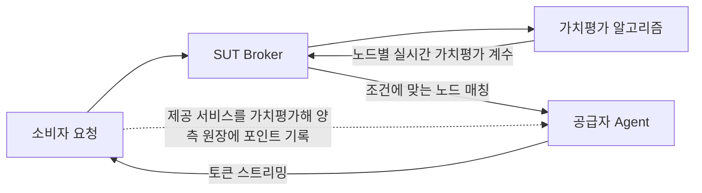

# SUT 실시간 가치평가 메커니즘 (Real-time Valuation Mechanism)

> **핵심 원칙**: 토큰 1개의 가치는 모델마다, 시간대마다 다릅니다. SUT는 **제공한 서비스를 실시간으로 가치평가해 공통 지표인 포인트(Point, P)로 돌려줍니다.** 가치평가 계수는 모델, 시간대별 수요·공급, 공급 자원의 소멸 위험, 노드 품질에 따라 알고리즘이 실시간 자동 산출합니다.

---

## 1. 왜 토큰이 아니라 포인트인가

토큰 수를 그대로 정산 단위로 쓰면 공정한 교환이 성립하지 않습니다.

| 차이 | 예시 |
| :--- | :--- |
| **모델별 가치 차이** | 상위 모델 1토큰과 경량 모델 1토큰은 연산량도, 공식 단가도 수 배~수십 배 다름 |
| **토큰 종류별 차이** | 같은 모델이라도 입력·출력·캐시 적중 토큰의 원가가 다름 |
| **시간대별 가치 차이** | 업무 시간대에는 수요가 몰려 공급이 귀하고, 심야에는 공급이 남음 |

포인트는 이 차이를 가치평가해 하나의 지표로 맞춰 주는 **평가 단위**입니다. 예를 들어 "심야에 경량 모델을 많이 공급한 사람"과 "업무 시간에 상위 모델을 조금 쓴 사람"의 기여와 사용을 같은 저울로 비교할 수 있습니다.

---

## 2. 핵심 가치평가 공식

노드 $i$가 시각 $t$에 모델 $m$으로 처리한 요청 1건의 포인트 $\text{Point}$는 다음과 같이 계산합니다.

$$\text{Point} = \Big(\sum_{k \in \{\text{in, out, cached}\}} N_k \times W_{m,k}\Big) \times \Phi(U_t) \times \Psi(\Delta t_i) \times \Omega(Q_i)$$

$$\text{단, } 0.5 \le \Phi \times \Psi \times \Omega \le 1.5$$

- **같은 값이 양쪽에 기록됩니다**: 소비자는 $-\text{Point}$, 공급자는 $+\text{Point}$입니다. 전체 포인트의 합은 항상 0입니다. (정산 구조는 [분산 원장 및 정산](ledger-and-settlement.md) 참조)
- **기준 단위**: 기준 모델의 입력 토큰 1,000개 = 1 P.

---

## 3. 변수 요약

| 변수 | 명칭 | 기본값 / 범위 | 설명 |
| :--- | :--- | :--- | :--- |
| **$N_k$** | 토큰 수 | 실측 | 입력(in), 출력(out), 캐시 적중 입력(cached) 토큰 수. 업스트림 응답의 `usage` 값 기준 |
| **$W_{m,k}$** | 모델 가중치 | 모델별 상이 | 모델 $m$의 토큰 종류 $k$가 기준 모델 입력 토큰 대비 몇 배의 가치인지 나타내는 비율 |
| **$\Phi(U_t)$** | 시간대 수요·공급 지수 | `0.8 ~ 1.2` | 시간대별 가동률(수요/공급)에 따른 변동 |
| **$\Psi(\Delta t_i)$** | 소멸 위험 계수 | `0.4 ~ 1.0` | 공급 자원이 실제로 소멸하는 경우에만 적용. 후불 API는 항상 `1.0` |
| **$\Omega(Q_i)$** | 품질(QoS) 가중치 | `0.85 ~ 1.1` | 실측 응답속도(TTFT, TPS) 및 에러율 기반 보정 |

---

## 4. 세부 동작 원리

### ① 모델 가중치 ($W_{m,k}$)
- 각 모델의 **공식 단가 비율**을 그대로 가중치로 씁니다. 예를 들어 어떤 모델의 출력 토큰 공식 단가가 기준 모델 입력 토큰의 20배라면 $W_{m,\text{out}} = 20$입니다.
- 상용 API 모델은 각 사 공식 가격표를, 로컬 오픈 모델은 같은 모델의 호스팅 API 시세를 기준으로 삼습니다. 가중치 표는 브로커가 주기적으로 갱신해 배포합니다.
- 공식 단가를 쓰는 이유는 **원가를 가장 객관적으로 반영하는 공개 지표**이기 때문입니다. 공급자는 자신이 실제로 부담한 원가만큼 포인트를 받습니다.

### ② 시간대 수요·공급 지수 ($\Phi(U_t)$)
- **가동률($U_t$) = 해당 시간대 요청량 / 해당 시간대 대기 공급량** (목표 가동률 $U^* = 60\%$)
- **수요가 몰리는 시간대** ($U_t > 60\%$): 지수를 올립니다. 이 시간대에 공급하면 포인트를 더 받으므로 공급이 늘어납니다.
- **공급이 남는 시간대** ($U_t < 60\%$): 지수를 낮춥니다. 이 시간대에 쓰면 포인트가 덜 차감되므로 급하지 않은 작업(번역, 대량 요약 등)이 이 시간대로 옮겨 갑니다.
- 결과적으로 **피크 시간대의 공급을 늘리고, 유휴 시간대의 사용을 늘리는** 방향으로 자원이 순환합니다.

### ③ 소멸 위험 계수 ($\Psi(\Delta t_i)$)

공급 자원이 **쓰지 않으면 실제로 사라지는 경우에만** 계수를 낮춥니다. $\Delta t_i$는 노드 $i$의 공급 자원이 소멸하기까지 남은 시간입니다.

| 공급 유형 | 소멸 여부 | $\Delta t_i$의 의미 | $\Psi$ 적용 |
| :--- | :--- | :--- | :--- |
| **후불 API 키** (사용량 과금) | 소멸 없음 | 해당 없음 | 항상 `1.0` |
| **선불 API 크레딧** | 소멸함 (예: OpenAI 선불 크레딧은 구매 후 1년 뒤 소멸) | 크레딧 만료일까지 남은 시간 | 만료 30일 이상 `1.0` → 7일 이내 점진 하향 → 24시간 이내 `0.4 ~ 0.5`. **만료 예정 잔액 한도 안에서만** 적용 |
| **로컬 GPU** (오픈 모델) | 소멸함. 유휴 GPU 시간은 저장해 둘 수 없음 | 현재 유휴 시간대가 끝나기까지 남은 시간 (공급자가 설정한 공유 가능 시간대 기준) | 노드 유휴율에 따라 `0.6 ~ 1.0` |

- **검증 불필요**: $\Psi$는 공급자가 **자기가 받을 포인트를 낮추는** 방향으로만 작동하므로, 공급자가 신고한 만료일이나 유휴 상태를 브로커가 검증하지 않아도 소비자에게 불리한 조작 유인이 없습니다.
- **비중에 대한 주의**: 선불 크레딧 만료는 1년 주기라 자주 일어나지 않습니다. 따라서 $\Psi$는 보조 계수이며, 가치평가는 주로 $W$(모델), $\Phi$(시간대), $\Omega$(품질)로 결정됩니다.

### ④ 노드 품질 보정 ($\Omega(Q_i)$)
- 브로커와 소비자가 측정한 실측 QoS 데이터로 자동 보정합니다.
- **초고속 저지연 노드** (낮은 TTFT, 높은 TPS): +5~10%.
- **불안정한 홈 네트워크** (높은 지연, 간헐적 지연): -15~30%.

---

## 5. 시나리오별 가치평가 예시

> 기준: 기준 모델로 입력 토큰 100만 개를 처리한 경우 (기본값 = 1,000 P)

| 상황 | 시간대 가동률 ($\Phi$) | 공급 유형 ($\Psi$) | 노드 품질 ($\Omega$) | 평가 포인트 | 기본값 대비 |
| :--- | :---: | :---: | :---: | :---: | :---: |
| **표준 상태** | 보통 60% (`1.0`) | 후불 API (`1.0`) | 표준 (`1.0`) | **1,000 P** | 기준 |
| **업무 시간 피크** | 높음 85% (`1.2`) | 후불 API (`1.0`) | 표준 (`1.0`) | **1,200 P** | +20% |
| **심야 공급 과잉** | 저조 25% (`0.8`) | 후불 API (`1.0`) | 표준 (`1.0`) | **800 P** | -20% |
| **선불 크레딧 만료 임박** | 보통 60% (`1.0`) | 선불, 만료 12시간 전 (`0.5`) | 표준 (`1.0`) | **500 P** | -50% |
| **로컬 GPU 유휴 시간대** | 보통 60% (`1.0`) | 로컬 GPU 유휴 (`0.7`) | 표준 (`1.0`) | **700 P** | -30% |
| **피크 + 프리미엄 노드** | 높음 80% (`1.1`) | 후불 API (`1.0`) | 초고속 (`1.065`) | **1,170 P** | +17% |

같은 처리량이라도 **상위 모델**($W = 4$로 가정)로 처리하면 표준 상태에서 4,000 P가 됩니다.

### 5.1 시연 시나리오: 공급원 간 가중치 차이

해커톤 시연에서는 가중치가 다른 두 공급원을 섞어, 같은 요청이라도 공급원에 따라 포인트가 다르게 정산되는 모습을 보여 줍니다. 두 공급원은 서로 다른 주체(예: 부서 A, 부서 B)가 각자 운영하는 노드에서 공급하며, 두 주체의 Broker가 서로만 연결된 폐쇄형 연합 안에서 공유합니다.

| 공급원 | 공급자 | $W_{\text{in}}$ | $W_{\text{out}}$ |
| :--- | :--- | :---: | :---: |
| **A: OpenAI API** | 주체 A의 공급자 노드 | 1.0 | 4.0 |
| **B: 삼성SDS 클라우드 Simple AI Inference** (오픈 가중치 중규모 LLM(GLM, Qwen, gpt-oss 계열 등 30B~150B급)) | 주체 B의 공급자 노드 | 0.5 | 2.0 |

> 가중치는 설명을 위한 가정값입니다. B는 최상위 상용 모델보다 성능과 단가가 낮은 중규모 모델이라 A보다 낮게 두었습니다. 실제 가중치는 각 공급원 모델의 공식 단가 비율로 산정합니다.

요청 1건 = 입력 10,000 토큰 + 출력 2,000 토큰, 표준 상태($\Phi = \Psi = \Omega = 1.0$)라고 하면:
- 공급원 A: $10 \times 1.0 + 2 \times 4.0 = 18$ P
- 공급원 B: $10 \times 0.5 + 2 \times 2.0 = 9$ P

| 단계 | 공급자 A | 공급자 B | 소비자 C | 합계 |
| :--- | :---: | :---: | :---: | :---: |
| 시작 | 0 | 0 | 0 | 0 |
| C가 A의 모델 사용 (18 P) | +18 | 0 | -18 | 0 |
| C가 B의 모델 사용 (9 P) | +18 | +9 | -27 | 0 |
| A가 B의 모델 사용 (9 P) | +9 | +18 | -27 | 0 |

같은 요청이라도 공급원에 따라 차감 포인트가 다르고, 공급자끼리도 서로의 모델을 쓰며 포인트가 순환하는 모습을 대시보드로 보여 줍니다.

---

## 6. 자동 매칭 및 가치평가 흐름

1. **소비자 요청**: 모델과 선호 조건(포인트 효율 우선 vs 속도 우선)을 전달합니다.
2. **가치평가 계수 산출**: Broker가 현재 시간대 지표를 바탕으로 가용 노드별 실시간 가치평가 계수을 계산합니다.
3. **자동 매칭**: 소비자 선호에 맞는 노드를 즉시 연결합니다.
4. **정산**: 스트리밍이 끝나면 실제 제공된 서비스를 가치평가해 소비자 -P, 공급자 +P로 기록합니다.
